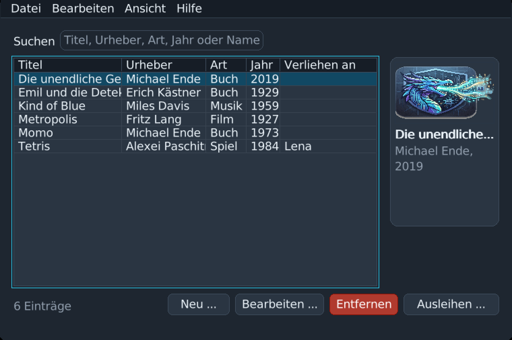

# Fenster, Formulare, Daten — Anwendungen bauen mit gui, Studio und Datenbank

Ein Buch, das eine Anwendung baut: eine Mediathek für die Bücher, Filme,
Spiele und Platten eines Haushalts. Am Ende hat sie Fenster mit Formularen
und Tabellen, eine Datenbank, eine Suche, ein Diagramm, eine Ausleihliste zum
Drucken und einen Export nach Excel; sie spricht Deutsch und Englisch, lässt
sich mit der Tastatur und mit einem Bildschirmleser bedienen und wird als
Programm mit Installer weitergegeben.



Der Weg hat zwei Hälften: In Teil I entsteht eine schlichte Mediathek von
Hand, mit dem gui-Modul in der IDE. Ab Teil II wird sie im
[Drachenhauch Studio](../../docs/studio.md) noch einmal gebaut — Fenster
zeichnen, Eigenschaften einstellen, Ereignisse schreiben. Für alle, die die
Sprache in den Grundzügen kennen: Variablen, Felder, Funktionen, eine erste
Klasse.

## Das Buch

| Zum Drucken (A4) | Für E-Reader |
|---|---|
| [`buch/Drachenhauch-Anwendungen.docx`](buch/Drachenhauch-Anwendungen.docx?raw=1) | [`buch/Drachenhauch-Anwendungen.epub`](buch/Drachenhauch-Anwendungen.epub?raw=1) |

Beide liegen auch dem Windows-Installer und jedem Release bei.

| Teil | Kapitel |
|---|---|
| 0 | Was eine Anwendung braucht — ein Rundgang durch die fertige Mediathek |
| I · Von Hand: das gui-Modul in der IDE | Ein Fenster und ein Knopf, Ordnung im Fenster, Listen und Tabellen, Daten, die bleiben, Formulare, die prüfen, Menüs, Kürzel, Dialoge, Was wir von Hand gelernt haben |
| II · Das Studio | Das erste Projekt, Der Inspektor, Code und Ereignisse, Mehrere Fenster, Der Debugger |
| III · Daten richtig | Das Datenbank-Element, Datenbindung, Abfragen, die rechnen, Aus dem Netz |
| IV · Fertig machen | Berichte und Drucken, Diagramme, Ein- und Ausfuhr, Aussehen, Für alle, Zwei Sprachen, Weitergeben, Was nun? |
| Anhang | Lösungen, Spickzettel gui und Studio, SQL kurz gefasst, von Hand oder Studio?, die Meldungen im Buch |

## Die Programme

Die Programme von Teil I liegen als einzelne Dateien in `code/kap01` bis
`code/kap06`, die Projekte des Studios in `code/kap08/mediathek` bis
[`code/kap24/mediathek`](code/kap24/mediathek) — jeweils so, wie sie am Ende
des Kapitels aussehen —, die Lösungen unter [`code/loesungen/`](code/loesungen).
Ein Projekt öffnet man im Studio; am besten eine Kopie, weil das Studio beim
Start in den Ordner schreibt.

Das Buch druckt seinen Code aus diesen Dateien ab, und die Prüfsammlungen
unter `tests/pruef/buecher/` lassen jedes Programm und jedes Projekt laufen
und bedienen es. Auch die Bilder entstehen so: `buch/studio_bilder.dh`
startet das Studio und die Programme und nimmt sie auf.

## Neu bauen

```
dhrt run tools/buch_bauen.dh -- buecher/anwendungen   # .docx mit Seitenzahlen im Inhalt
cd buecher/anwendungen/buch && node build_epub.js     # .epub
```
