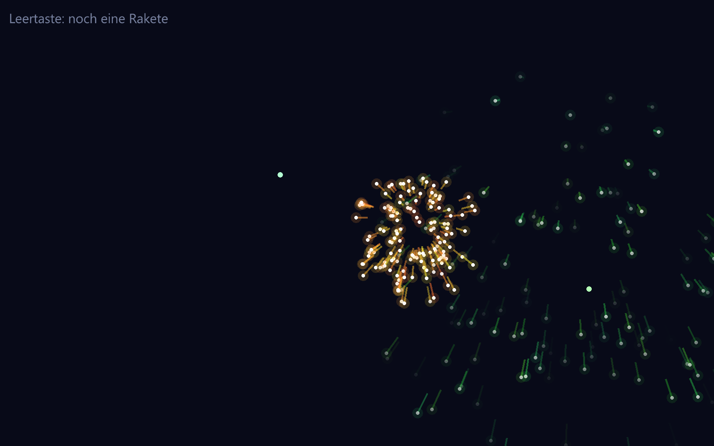

# Kleine Wunder — die Sprache an Programmen, die man gern ansieht

Ein Buch, das Drachenhauch lehrt, ohne je ein Programm zu zeigen, das nur
eine Sprachregel vorführt. Jedes Kapitel baut etwas zum Ansehen: einen
Sternenflug, ein Feuerwerk, ein Fraktal, einen Schwarm, ein Instrument, eine
Landschaft, über die man fliegt. Die Sprache lernt man unterwegs, dort, wo
sie gebraucht wird — und mit dem Grund, warum man sie an dieser Stelle so und
nicht anders einsetzt.



Für alle, die die Grundlagen schon haben: Variablen, Schleifen,
Entscheidungen, ein Fenster mit `SCREEN` — den Stoff der ersten zehn Kapitel
von [Der Einstieg](../einstieg/README.md), oder was man aus einer anderen
Sprache mitbringt.

## Das Buch

| Zum Drucken (A4) | Für E-Reader |
|---|---|
| [`buch/Drachenhauch-Wunder.docx`](buch/Drachenhauch-Wunder.docx?raw=1) | [`buch/Drachenhauch-Wunder.epub`](buch/Drachenhauch-Wunder.epub?raw=1) |

Beide liegen auch dem Windows-Installer und jedem Release bei.

| Teil | Kapitel |
|---|---|
| 0 | Die Werkstatt |
| I · Zeichnen mit Zahlen | Sternenflug, Plasma, Spirograph, Das Ziffernblatt |
| II · Viele Dinge auf einmal | Feuerwerk, Das Spiel des Lebens, Fallender Sand, Schwarm |
| III · Bewegung, die sich echt anfühlt | Federn und Seile, Bälle in der Kiste, Sanft ankommen, Ein Garten wächst |
| IV · Bilder, Licht und Farbe | Die Mandelbrotmenge, Wolken und Landschaften, Leuchten, Pixelkunst und Paletten |
| V · Spielereien mit Eingaben | Malen mit Symmetrie, Der Theremin, Ein Bild, das zuhört |
| VI · Die Sprache für Fortgeschrittene | Die Partikelmaschine, Geschichten, die warten, Die Datenwerkstatt, Fehler, die man fängt |
| VII · Die dritte Dimension | Würfel, Licht und Schatten, Flug über eine Landschaft, Das große Finale — eine Demo |
| Anhang | Lösungen, Spickzettel der Sprache, Farben/Tasten/Formeln, die Meldungen im Buch, wie es weitergeht |

## Die Programme

Jedes Programm und jeder Zwischenstand liegt unter [`code/`](code), je
Kapitel ein Ordner, die Lösungen der Übungen unter
[`code/loesungen/`](code/loesungen). Das Buch druckt seinen Code aus diesen
Dateien ab, und die Prüfsammlungen unter `tests/pruef/buecher/` lassen jedes
Programm laufen und vergleichen jede abgedruckte Ausgabe und Meldung mit dem,
was `dhrt` wirklich ausgibt. Auch die Bilder entstehen aus den Programmen.

```
dhrt run buecher/wunder/code/kap05/3_feuerwerk.dh
```

## Neu bauen

```
dhrt run tools/buch_bauen.dh -- buecher/wunder   # .docx mit Seitenzahlen im Inhalt
cd buecher/wunder/buch && node build_epub.js     # .epub
```

## Englisch

Die englische Fassung („Little Wonders“) entsteht aus denselben Kapiteln:
`--lang en` schickt jeden Text durch den Katalog `buch/i18n/en.json`;
fehlt ein Eintrag, bleibt der deutsche Satz stehen. Der Text ist
vollständig übersetzt, samt Kommentaren in den abgedruckten Programmen.
Noch deutsch sind die Programme selbst (Namen und Texte im Code), ihre
Ausgaben und die Meldungen von dhrt. Begriffe und Entscheidungen stehen in
`buch/i18n/LEITFADEN.md`. Die Werkzeuge teilt das Buch mit dem Lehrbuch
(`buecher/_i18n/`):

```
cd buecher/wunder/buch
node extract_strings.js en          # neue Texte in den Katalog
node fehlend.js en                  # was je Kapitel noch fehlt
node offen.js en 05_feuerwerk       # die offenen Texte eines Kapitels
dhrt run ../../referenz/buch/i18n/apply.dh -- patch.json i18n/en.json
node build_epub.js --lang en        # Drachenhauch-Wonders.epub
```

Bilder, die es nur englisch gibt (die IDE mit englischer Oberfläche),
liegen in `buch/images/en/` und kommen mit `ide_bilder.dh -- --lang en`.
