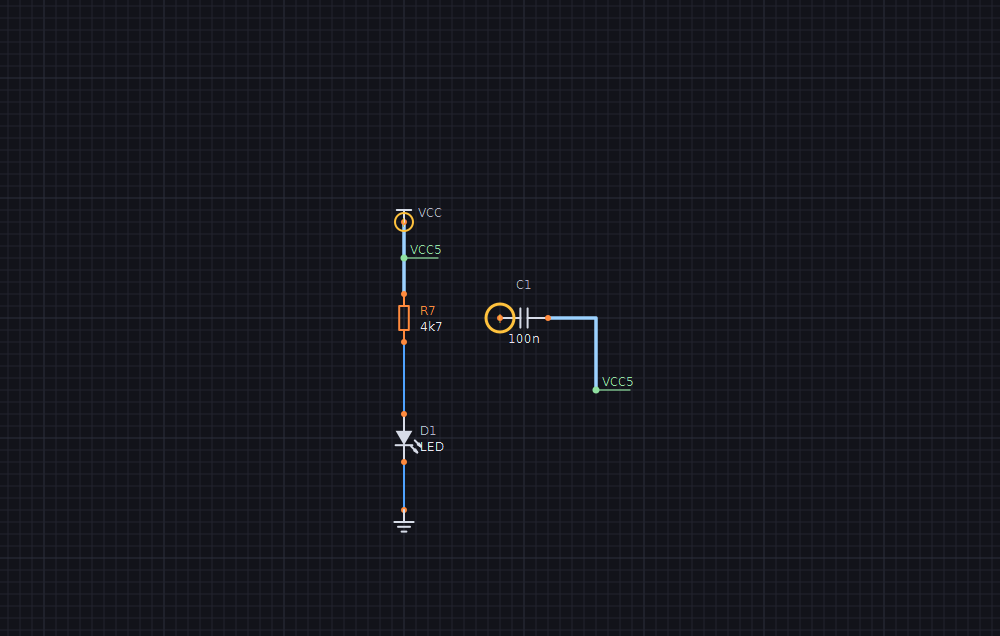
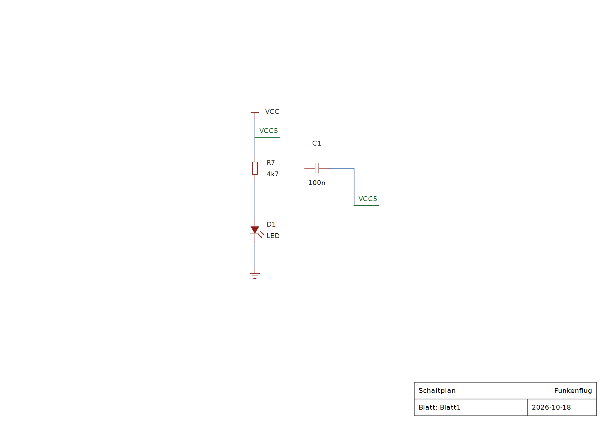
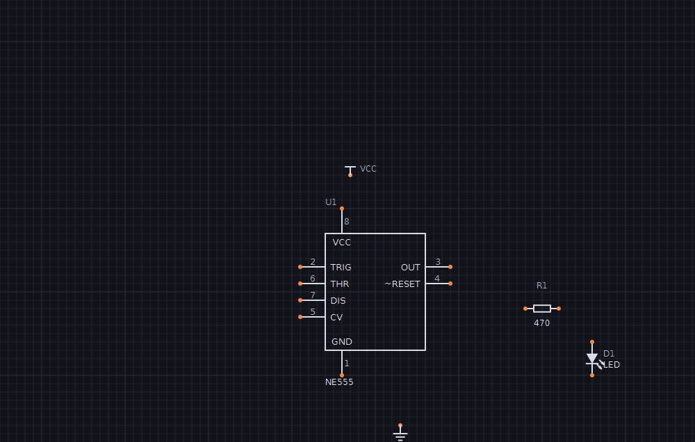
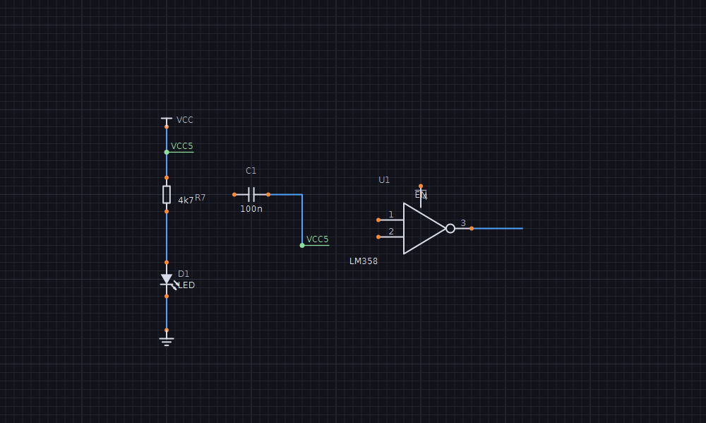
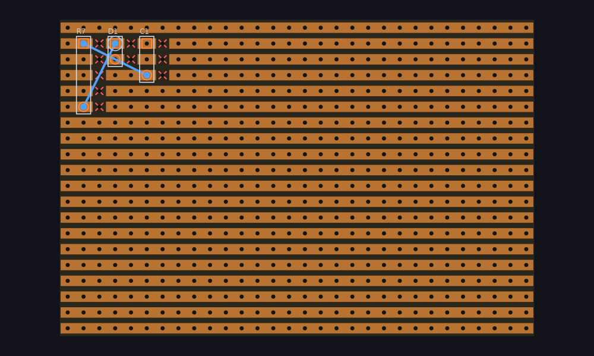

# Funkenflug

Ein **Schaltplan-Editor in Drachenhauch** mit GTK 3 als Oberfläche – die
Neufassung der Idee hinter [SparkNode](https://github.com/HasoSchno70/elektronik)
(ursprünglich Python + PySide6). GTK/Cairo-Ansatz wie bei *Glutfaden* (der
GTK-Portierung von PySticky).



## Starten

```
dhrt run funkenflug/main.dh                       # Demo-Schaltung
dhrt run funkenflug/main.dh -- schaltplan.fkn      # eine Datei öffnen
dhrt run funkenflug/main.dh -- --foto bild.png     # Selbsttest (headless, PNG)
```

GTK 3 muss vorhanden sein: unter Linux fast immer (`libgtk-3-0`), unter macOS
über Homebrew (`brew install gtk+3`), unter Windows aus MSYS2 im PATH – oder aus
einem Programm, das es mitbringt (**Inkscape**, GIMP). Die Bibliotheks-Namen in
`gtk/gtk.dh` nennen diese Fundorte durch `|` getrennt.

## Bedienung

| Werkzeug | |
|---|---|
| **Auswahl** (Taste `A`) | Bauteil, Label oder Draht anklicken, ziehen zum Verschieben; auf freier Fläche einen **Rahmen** aufziehen (wählt alles ganz Umschlossene), `Umschalt` ergänzt bzw. schaltet einzelne Elemente um; **Doppelklick**, `E` oder `Enter` bearbeitet (Bauteil: Referenz/Wert; Label und Draht: Netz umbenennen). **Referenz oder Wert anfassen** verschiebt nur den Text (0,5-mm-Raster, dreht mit dem Bauteil mit); `T` setzt die Texte der gewählten Bauteile zurück |
| **Draht** (Taste `W`) | klicken setzt Eckpunkte, Doppelklick / `Enter` / rechte Maustaste schließt ab, `Esc` bricht ab. Enden fangen an Pins und Drahtenden |
| **Label** (Taste `L`) | klicken, Netznamen eingeben. Der Anker ist der elektrische Punkt; **gleichnamige Labels sind ein Netz**. Mit dem Haken „global" wird es ein globales Label (Fahne) und verbindet über alle Blätter; `G` schaltet gewählte Labels um. `R`/`X`/`Y` legen die Richtung fest (rechts, unten, links, oben) – vorher für das nächste Label, danach für das gewählte, das um seinen Anker dreht |
| **Bauteil** | in der Leiste aus der Liste wählen, dann auf die Fläche klicken; rechte Maustaste oder `R` dreht die Vorschau |

**Aktiv-low:** `~{RESET}` in Pin-Namen und Labels wird überstrichen gezeichnet,
ebenso die ältere Schreibweise `~CS~/WR` (die Tilde schaltet den Strich um; `~~`
ist eine echte Tilde). Der Netzname bleibt der geschriebene Text.

Weiteres: `Strg+Z` / `Strg+Y` (oder `Strg+Umschalt+Z`) bzw. die Pfeile in der
Kopfleiste machen rückgängig und wiederholen. `R` dreht die Auswahl, `Entf`
löscht sie, Mausrad zoomt um den Zeiger, mittlere Maustaste schiebt,
`+`/`-`/`0` zoomen, `Strg+S` speichert, `Strg+O` öffnet. Eine schon vergebene
Referenz lehnt der Eigenschaften-Dialog ab. Er kennt auch **Gehäuse** und
**Bestellnummer** für die Stückliste. Sind mehrere Bauteile gewählt, bearbeitet
`E` Wert, Gehäuse und Bestellnummer aller zugleich – ein Feld, das man nicht
anfasst, bleibt je Bauteil, wie es war (etwa: allen Widerständen `0805` geben,
die Werte bleiben).

**Gummiband:** Zieht man Bauteile (einzeln oder als Auswahl), wandern die
angeschlossenen Drahtenden mit. Damit die Leitung rechtwinklig bleibt, rückt
die Nachbarecke mit oder es entsteht ein Knick; Drähte, deren beide Enden
mitwandern, verschieben sich starr, ebenso Labels an bewegten Pins. Das
Gummiband **erfindet nie eine Verbindung**: Würde ein Knick einen fremden Pin,
ein Label oder einen anderen Draht berühren (etwa wenn beim Drehen beide
Anschlüsse eines Widerstands zum selben Punkt knicken), nimmt es den Knick
andersherum oder zuletzt eine Schräge.

**Drehen und Spiegeln:** `R` dreht um 90°, `X` spiegelt links/rechts, `Y`
oben/unten – ein Bauteil um seinen Ursprung, eine Auswahl um ihre Mitte (auf
dem Raster, damit alle Pins auf dem Raster bleiben). Angeschlossene Drähte
folgen per Gummiband, ein Rückgängig-Schritt. Beim Platzieren gelten
`R`/`X`/`Y` der Vorschau.

**Blätter:** Reiter über der Zeichenfläche, `Bild↑`/`Bild↓` blättern, Knopf
„Blatt ▾" legt an, benennt um und löscht (jeweils ein Rückgängig-Schritt; ein
volles Blatt fragt vorher, das letzte bleibt). **Globale Labels** (Fahne) und
Versorgungssymbole verbinden gleichnamige Netze auf allen Blättern, **lokale
Labels nur auf ihrem Blatt** – gleiche lokale Namen auf zwei Blättern sind zwei
Netze und heißen dann `Blatt/Name`. Referenzen zählen über alle Blätter (kein
zweites R1), Netzliste, Stückliste und ERC umfassen das ganze Dokument; eine
ERC-Zeile springt auch aufs richtige Blatt. Die Statuszeile nennt das Blatt.

**Ausgabe** (Knopf „Ausgabe ▾" in der Kopfleiste): **PDF**, **SVG** und
**PNG** (150 dpi), **Drucken** über den Druckdialog des Systems, dazu
Stückliste und Netzliste. Alles läuft durch dieselbe Zeichenroutine wie der
Bildschirm, nur mit Druckfarben auf Weiß, ohne Raster, Auswahl und Pin-Punkte,
auf A4 quer eingepasst (kleine Schaltungen höchstens 3:1) und mit Schriftfeld.
PDF und Druck haben **eine Seite je Blatt** („Blatt: Takt (2 von 3)"), SVG und
PNG zeigen das aktuelle Blatt.



**Eigene Bauteile und ICs** (Knopf „Symbol …" in der Leiste; ist ein eigenes
Bauteil gewählt, bearbeitet er dessen Symbol): Name, Präfix, Wert und eine
**Pinliste**, eine Zeile je Pin –

```
# Nummer  Name   Seite   Typ
1  GND    unten   vin
2  TRIG   links   ein
3  OUT    rechts  aus
8  VCC    oben    vin
```

Seite: `links rechts oben unten` (Vorgabe links), Typ: `passiv ein aus bidir
vin vout nc` (Vorgabe passiv). Fehler stehen zeilengenau unter der Liste,
rechts zeigt eine Vorschau das Symbol, genau wie es im Schaltplan erscheint.
Gehäuse und Pins legt der Generator rasterfest an, Pin-Nummern und -Namen
werden mitgezeichnet. Die Pin-Typen gehen in den ERC (Eingang ohne Treiber,
Ausgänge gegeneinander …).



**Freie Grafik:** In dieselbe Liste dürfen Zeichenbefehle (Maße in mm, Komma
oder Punkt, y nach unten, 0/0 = Bauteil-Ursprung):

```
linie    -2 -3  3 0  -2 3  -2 -3     # Polylinie, "voll" am Ende füllt
rechteck x1 y1 x2 y2 [voll]
kreis    3,5 0 0,5 [voll]
bogen    0 0 4 0 90                  # Mitte, Radius, Winkel (Grad, im Uhrzeigersinn)
text     0 -4 ~{EN}
pin 1 IN-  -5 -1 links ein           # Nummer Name x y Seite [Typ] [Länge]
pin 3 OUT   6  0 rechts aus 2
```

Ein `pin` sitzt mit seinem elektrischen Punkt auf (x, y) – der muss auf dem
1-mm-Raster liegen, sonst ließe er sich nicht anschließen; die Seite sagt,
wohin er absteht. Gibt es Seiten-Pins, baut der Generator sein Rechteck und
die Grafik kommt dazu (Logo, Innenleben); ohne Seiten-Pins ist das Symbol ganz
frei. Frei gesetzte Pins zeigen ihre Nummer, den Namen nicht (er gilt weiter
für ERC und Netzliste). Text-Elemente bleiben beim Drehen aufrecht.



Eigene Symbole **stecken in der `.fkn`** – eine Datei bleibt eigenständig,
auch auf einem anderen Rechner. Mit dem Haken „auch in meiner Bibliothek
speichern" landen sie zusätzlich in `%APPDATA%\Funkenflug\symbole.fkl`
(Linux: `~/.config/funkenflug/`, abweichend per `FUNKENFLUG_BIBLIOTHEK`) und
stehen in jedem Projekt in der Bauteilliste. Ein Symbol bearbeiten ändert alle
Bauteile, die es benutzen – ein Rückgängig-Schritt. Fehlt ein Symbol wirklich,
erscheint ein roter Platzhalter, und der ERC meldet es.

**Stückliste** (Kopfleiste): gruppiert nach Bauteil, Wert, Gehäuse und
Bestellnummer (10k in 0805 und in 1206 sind zwei Positionen), natürlich
sortiert (R2 vor R10), Bereiche zusammengefasst (`R1-R3, R10`), ohne
Versorgungssymbole; Export als CSV (Semikolon, immer mit Gehäuse- und
Bestellnummer-Spalte), Markdown oder Text (diese Spalten nur, wenn belegt).

**Ablage:** `Strg+C` kopiert, `Strg+X` schneidet aus, `Strg+V` fügt an der
Mausposition ein, `Strg+A` wählt alles. Das läuft über die Zwischenablage des
Systems, also auch zwischen zwei Funkenflug-Fenstern. Eingefügte Bauteile
bekommen freie Referenzen (eine Kopie von R1 wird z. B. R8), Labels und
Versorgungen behalten ihre Namen und hängen damit am selben Netz wie das
Original. Das Eingefügte ist danach gewählt und lässt sich gleich verschieben.

**Drähte:** Ein Klick wählt das Segment unter der Maus. Ziehen verschiebt nur
dieses Segment – waagrechte senkrecht, senkrechte waagrecht, damit die Nachbarn
rechtwinklig bleiben. Hängt an einem Drahtende etwas (Pin, Label, anderer
Draht), bleibt das Ende stehen und ein Verbindungsknick entsteht: Ziehen reißt
keine Verbindung ab. Danach räumt Funkenflug den Draht auf (Ecken auf einer
Geraden fallen weg). `Entf` löscht das Segment, der Draht zerfällt in die
Reststücke; `Umschalt+Entf` löscht den ganzen Draht.

**Umbenennen** (`F2`, oder Doppelklick auf Label/Draht): Ein Netzname wird an
**allen Stellen** ersetzt – gleichnamige Labels und Versorgungssymbole (aus GND
wird so z. B. `AGND`, es bleibt trotzdem SPICE-Masse). Bei einem Label lässt
ein Haken auch nur dieses eine umbenennen. Hat das Netz nur einen automatischen
Namen, setzt Funkenflug ein Label an die angeklickte Stelle. Trägt ein anderes
Netz den neuen Namen schon, fragt es vorher – Umbenennen würde beide verbinden.

**Netze:** Fährt die Maus über einen Draht, einen Pin oder ein Label, zeigt die
Statuszeile den Netznamen samt Pinzahl und die Drähte des Netzes leuchten auf.
Namen: Versorgungssymbol (GND, VCC, auch ein umbenanntes wie `+5V`) vor globalem
vor lokalem Label vor automatisch (`N1`, `N2` …). Gleichnamige Versorgungen und Labels sind ein Netz,
auch ohne Draht.

**ERC** (Kopfleiste): listet Fehler und Warnungen in einem Fenster, das offen
bleiben darf; eine Zeile anklicken holt die Stelle in die Mitte, auf der Fläche
markieren Kreise jede Stelle. Geprüft werden doppelte und fehlende Referenzen,
offene Pins, offene Drahtenden, kurzgeschlossene Bauteile (zwei Pins im selben
Netz), mehrere Labels an einem Netz, Labels auf einer fremden Versorgung,
**Kurzschlüsse zwischen Versorgungen** und die Pin-Typen gegeneinander (zwei
Ausgänge, Ausgang gegen Versorgung, Eingang ohne Treiber …), dazu globale Labels,
die es nur einmal gibt (sie verbinden nichts). Versorgungssymbole
gelten als Quelle – ein PWR_FLAG wie in KiCad braucht es nicht.

**Netzliste** (Kopfleiste): das Format folgt der Endung – `.cir`/`.sp` SPICE
(direkt für ngspice: GND wird Knoten `0`, `4k7` → `4.7k`, `1M` → `1Meg`, denn
`M` heißt in SPICE *milli*; Dioden und Transistoren bekommen `.model`-Zeilen),
`.csv` (Semikolon) oder `.net`/`.txt` als lesbarer Text.

## Platine (Lochraster / Streifenraster)

„Platine" in der Kopfleiste schaltet auf die Lochraster-Sicht desselben
Dokuments (eigener Ausschnitt, eigene Werkzeugleiste). Welche Pins
zusammengehören, sagt **allein der Schaltplan**; die Platine sagt nur, wo die
Teile stecken und wie das Kupfer verbunden ist. Die Prüfung vergleicht beides
laufend:

- **Luftlinien** (gelb): im Schaltplan verbunden, auf der Platine noch nicht –
  je Netz die kürzesten Strecken zwischen den Kupfer-Inseln.
- **Kurzschluss** (rot): zwei Netze auf demselben Kupferstück.
- **Hinweise** (orange): doppelt belegtes Loch, Bein außerhalb der Platine, Bein
  in einer Trennstelle, unbekanntes Gehäuse.

`ERC` heißt in dieser Sicht „Platine prüfen" und listet alles; eine Zeile
springt hin. Die Statuszeile nennt das Netz des Lochs unter der Maus.

| Werkzeug | |
|---|---|
| **Auswahl** (`A`) | Teil ziehen (lochweise), `R` dreht – am Rand rückt es ein, statt still abgelehnt zu werden –, `Entf` nimmt es herunter; eine Bahn anklicken und `Entf` löscht sie. Ein **Rahmen** über leerer Fläche wählt alle Teile darin, `Umschalt` nimmt einzelne dazu oder heraus, `Strg+A` alle; ein Klick in die Auswahl zieht die ganze Gruppe, `R` und `Entf` gelten für alle |
| **Bahn** (`B`) | Loch für Loch klicken, rechte Taste beendet. Auf Lochraster ist eine gerade Bahn eine **Lötbahn** (verbindet jedes Loch auf ihrem Weg), sonst – und immer auf Streifenraster – eine **Drahtbrücke** (nur ihre Enden); `Umschalt` erzwingt die Brücke |
| **Trennen** (`T`) | Streifen an einem Loch auftrennen bzw. wieder schließen |

**Verbinden** (`V`) legt für alle Luftlinien einen Vorschlag – auf
Streifenraster eine Drahtbrücke zwischen freien Löchern der beiden
Kupferstücke (gerade, wo eine gemeinsame Spalte frei ist, sonst die kürzeste),
auf Lochraster Lötbahnen auf dem kürzesten Weg über freie Löcher. Jeder
Vorschlag wird sofort geprüft: was einen Kurzschluss gäbe oder nichts hilft,
fliegt wieder raus; was keinen Weg findet, bleibt Luftlinie. Alles zusammen
ist ein Rückgängig-Schritt. Kein Autorouter, der still Platz verbraucht –
jede Brücke steht danach in der Arbeitsliste.

**Einsetzen** setzt alle Teile, die noch fehlen – **nach Netzen**: zuerst das
Teil mit den meisten Verbindungen, dann immer das, das am meisten mit schon
Gesetztem teilt, dorthin, wo seine Beine den gesetzten Beinen derselben Netze
am nächsten sind (auf Lochraster quer oder längs, was kürzer ist). Eine Kette
aus sechs Widerständen, im Schaltplan durcheinander, braucht so 19 statt 44
Löcher Luftlinie (Lochraster: 17 statt 62). Auf Streifenraster stehen sie
quer zu den Streifen (sonst lägen beide Beine eines Widerstands auf einem
Streifen), rechts neben jedem Teil und unter einem DIP zwischen den Reihen
wird getrennt, und rechts bleibt ein freies Loch, damit jedes Teil auf seinem
Streifenstück Platz für eine Brücke hat – es entsteht nie ein Kurzschluss,
was fehlt, zeigen die Luftlinien. Bauteile, die im Schaltplan gelöscht wurden, verschwinden beim
Umschalten von der Platine (ein Rückgängig-Schritt).

Die **Bauform** ist das Gehäuse-Feld des Bauteils: `AX4` (axial, 4 Löcher),
`RAD2`, `RAD1`, `TO92-CBE` (Beinfolge nach Pin-Namen, auch `TO92-GDS` für FETs),
`TO220-GDS`, `TO92`/`TO220` ohne Folge (Pins 1 2 3), `DIP8`, `SIL3`, `HDR2X5`
(Stiftleiste 2 × 5, Pin 1 und 2 nebeneinander), `TRIM` (stehender Trimmer).
Eigene Symbole bringen ihre Bauform in der Pinliste mit: `bauform DIP8` als
Vorgabe oder ganz eigen je Pin `loch Nr Spalte Zeile` (z. B. ein Relais mit
versetzten Beinen); der Editor meldet fehlende, doppelte und unbekannte
Löcher zeilengenau. Ein Gehäuse am Bauteil geht immer vor. Ohne
Angabe gilt eine Vorgabe je Symbol (Widerstand/Diode AX4, Kondensator RAD2,
Elko/LED RAD1, NPN TO92-CBE, eigene ICs DIP bzw. SIL). Platine, Teile, Bahnen
und Trennstellen stecken in der `.fkn` und im Rückgängig.



**Ausgabe** (Menü „Ausgabe ▾" → „Platine als PDF (1:1)" bzw. „Platine drucken
(1:1)"): drei Teile – **Bestückungsseite** (von oben: Umriss und Referenz je
Teil, Pin 1 eckig, Brücken blau), **Lötseite** (von unten, links/rechts
gespiegelt: Streifen, rote Kreuze an den Trennstellen, Lötbahnen, Brücken-
Enden) und die **Arbeitsliste** (Trennstellen, Brücken mit Drahtlänge in mm,
Bauteile mit Wert, Bauform und Loch von Bein 1). Gerechnet wird 1:1 – ein Loch
sind 2,54 mm, der Ausdruck passt auf die Platine. Die Spalten-Nummern am Rand
sind auf beiden Seiten die der Bestückungsseite, damit die Liste überall
stimmt. Jede Seite hat einen 10-mm-Balken zum Nachmessen; stellt der
Druckdialog „an Seite anpassen" ein, sieht man es dort. Passt eine große
Platine nicht auf A4, wird verkleinert, und der Kopf sagt es rot. Der Kopf
nennt auch den Prüfstand (offene Verbindungen, Kurzschlüsse).

## Aufbau

```
kern/       Modell, Geometrie, Bibliothek, Netze, Datei – ohne Oberfläche,
            Namensraum "kern"
  geometrie.dh   Punkt, Lage (Transform), Raster/Snap, Konstanten
  text.dh        Überstrich ~{RESET}: sichtbarer Text, Pango-Markup
  modell.dh      Pin, Primitiv, Symbol, Bauteil, Draht, Knoten, Label, Blatt, Dokument
  bibliothek.dh  10 eingebaute Symbole (R, C, Elko, L, Diode, LED, NPN, Schalter, GND, VCC)
  netze.dh       Netz-Erkennung (eine reine Funktion), benannte Netze, Auto-Knoten
  erc.dh         Elektrische Regelpruefung
  netzliste.dh   Export: SPICE, CSV, Text
  symbole.dh     eigene Symbole: Pinliste, IC-Generator, JSON, Register, Bibliothek
  stueckliste.dh Stückliste: Gruppen, natürliche Sortierung, CSV/Markdown/Text
  platine.dh     Bauformen, Platinen-Pruefung (Inseln, Luftlinien, Kurzschluesse), Einsetzen
  datei.dh       Speichern/Laden als .fkn (JSON, Version 1)
gtk/        Deklarationen für GTK 3, GDK, Cairo, Pango, GLib (aus Glutfaden)
ansicht/    Zeichenfläche und Werkzeuge – globaler Namensraum
  leinwand.dh    Welt↔Schirm, Grid, Zeichnen von Bauteilen/Drähten/Knoten/Labels
  werkzeuge.dh   Maus, Tastatur, Werkzeug-Logik
  verlauf.dh     Rückgängig/Wiederholen
  auswahl.dh     Auswahl als Menge, Rahmen, Gruppen-Zug mit Gummiband, Ablage
  symboleditor.dh  Symbol-Editor mit Vorschau
  ausgabe.dh     PDF, SVG, PNG, Drucken, Menü „Ausgabe"
  blaetter.dh    Reiter, Menü „Blatt": neu, umbenennen, löschen
  platinenansicht.dh  Lochraster-Sicht: Zeichnen, Werkzeuge, Pruefliste
  platinendruck.dh    Platine 1:1: Bestueckung, Loetseite, Arbeitsliste (PDF, Druck)
main.dh     Fenster, Kopfleiste, Werkzeugleiste, Statuszeile, Dialoge
```

Die Tests laufen ohne Mensch: `dhrt run funkenflug/pruef_kern.dh` prüft Modell,
Transform, Raster, Netze (auch T-Verbindung und Labels) und Save/Load.
`main.dh -- --foto bild.png` spielt die Werkzeuge durch – **samt der echten
Dialoge**, die ein Timer ausfüllt und bestätigt –, prüft Undo/Redo, gibt je
Prüfung `ok`/`FEHLER` aus und zeichnet das Fenster in eine PNG (211 Prüfungen,
darunter Drehen/Spiegeln einzeln und als Gruppe ohne Kurzschluss, PDF/SVG/PNG
und Drucken über GTKs Export-Weg, die echten Werkzeug-Knöpfe, Symbol-Editor,
Stückliste, Gummiband, Rahmen und Gruppen-Zug über den Klick-Handler,
Kopieren/Einfügen, Umbenennen, ERC und SPICE, mehrere Blätter mit Reitern,
globalem Label über den Dialog-Haken, ERC-Sprung aufs Blatt und mehrseitigem
PDF/Druck, gedrehte Labels samt Treffer-Test, Gehäuse/Bestellnummer einzeln
und für mehrere Bauteile, Referenz ziehen/drehen/zurücksetzen, frei
gezeichnetes Symbol platzieren und anschließen, Platine: umschalten,
einsetzen, Brücken entlang der Luftlinien klicken, trennen, ziehen, drehen am
Rand, Prüfliste, Art umschalten, Speichern, Verbinden, PDF/Druck der Platine
1:1). `pruef_kern.dh` prüft u. a. die
Gruppen-Lage in allen 8 Orientierungen × 3 Arten (72 Pin-Prüfungen). Der Selbsttest
lässt die Zwischenablage des Systems in Ruhe und schreibt seine Bibliothek in
eine Wegwerf-Datei neben dem Bild. `--nur-foto bild.png` macht nur das Bild.

## Was gegenüber SparkNode bewusst anders ist

SparkNode hatte mehrere Konzeptfehler, die hier von Anfang an vermieden sind:

1. **Eine Rotations-/Transform-Konvention für Modell UND Zeichnen.** In
   SparkNode drehte das Modell gegen, der Maler (`QPainter`) mit dem
   Uhrzeigersinn – gedrehte Pins lagen gespiegelt zu den elektrischen. Hier geht
   **alles** durch `kern.transformPunkt` / `kern.transformRichtung` (Y nach
   unten, Drehung im Uhrzeigersinn), und der Canvas baut seine Cairo-Matrix so
   auf, dass sie dieselbe Rechnung ist. Gezeichnet == elektrisch, per
   Konstruktion.
2. **Pin-Punkt eindeutig.** `pin.pos` IST der elektrische Andockpunkt;
   `pin.laenge` ist nur der gezeichnete Stummel. Kein Nebeneinander von
   „position" und „connection point".
3. **Eine Netz-Erkennung.** `kern.netzeDokument` ist die einzige Quelle für
   Konnektivität – fürs ganze Dokument, ERC, Netzliste, Stückliste und
   Anzeige nutzen dieselbe Rechnung. Alle Punkte aufs Raster
   quantisiert; T-Verbindung zählt, eine reine Kreuzung ohne Knoten nicht.
4. **Label-Anker getrennt von Darstellung.** Der Anker ist der elektrische
   Punkt; Text und Unterstrich sind nur Anzeige und verschieben ihn nie.
5. **Undo über vollständige Schnappschüsse** statt einzelner Befehle. SparkNodes
   Undo-Fehler kamen von Befehlen, die nur einen Teil des Zustands kannten
   (welches Blatt, Annotation). Ein Schnappschuss kennt immer alles; Ziehen ist
   ein Schritt, ein bloßer Klick keiner.
6. **Bewusst weggelassen** (in SparkNode überproportional viele Bugquellen):
   Bus/Bus-Entry, Hierarchie-Sheets, Pin-Swap, Multi-Unit, auf der Platine
   ein Autorouter, der alles auf einmal legt (Verbinden schlägt je Luftlinie
   vor und prüft jeden Vorschlag), und Autoplatzierung nach Netzen. Kommt erst, wenn wirklich
   gebraucht.
7. **Platine ohne zweite Wahrheit.** SparkNode hielt Footprint und Netzliste
   der Platine getrennt vom Schaltplan und brauchte einen „Transfer"; hier ist
   die Bauform das Gehäuse-Feld und die Netze kommen bei jeder Prüfung frisch
   aus dem Schaltplan. Die Platine merkt sich nur Lage, Kupfer und Trennstellen.

## Hinweis für Drachenhauch-Code

`/` liefert in Drachenhauch **immer** eine Kommazahl (seit 2026-09-24), auch
bei zwei ganzen Zahlen; ganzzahlig teilt `\`. `rastern()` hatte das falsch und
verschob jeden Punkt um ein halbes Raster – unbemerkt, weil `RETURN` eines
ganzzahligen Kommawerts aus einer `AS INTEGER`-Funktion still durchgeht.

Namen unterscheiden **keine Groß-/Kleinschreibung**: `pd` und `pD` sind
dieselbe Variable. Ein Test, der ein Dokument `pd` und eine LED `pD` nannte,
reichte die LED als Dokument weiter. Der Compiler warnt zwar („schon als A
angelegt, hier als B"), läuft aber weiter – die Warnung ging in der langen
Testausgabe unter, der Fehler kam erst zur Laufzeit.

`MID$` zählt ab **0**, und `INSTR` liefert die 0-basierte Position oder **-1** –
anders als QBasic/VB. `INSTR(...) > 0` übersieht deshalb einen Treffer ganz
vorn; besser `CONTAINS(s, teil)`. Genau daran vergab Funkenflug anfangs jedem
zweiten Kondensator wieder „C1".

## Noch offen (nächste Runden)

Hierarchische Blätter (Blatt-Symbole mit Ports), Symbol-Grafik mit der Maus
zeichnen (bisher als Text), Platine: eine Gruppe als Ganzes drehen (bisher
dreht jedes Teil um sich selbst).
