# Funkenflug

Ein **Schaltplan-Editor in Drachenhauch** mit GTK 3 als Oberfläche – die
Neufassung der Idee hinter [SparkNode](https://github.com/HasoSchno70/elektronik)
(ursprünglich Python + PySide6). GTK/Cairo-Ansatz wie bei *Glutfaden* (der
GTK-Portierung von PySticky).


## Starten

```
dhrt run funkenflug/main.dh                       # Demo-Schaltung
dhrt run funkenflug/main.dh -- schaltplan.fkn      # eine Datei öffnen
dhrt run funkenflug/main.dh -- --foto bild.png     # Selbsttest (headless, PNG)
```

GTK 3 muss vorhanden sein: unter Linux fast immer (`libgtk-3-0`), unter macOS
über Homebrew (`brew install gtk+3`), unter Windows aus MSYS2 im PATH – oder aus
einem Programm, das es mitbringt (**Inkscape**, GIMP). Die Bibliotheks-Namen in
`gtk/gtk.dh` nennen diese Fundorte durch `|` getrennt.

## Bedienung

| Werkzeug | |
|---|---|
| **Auswahl** (Taste `A`) | Bauteil, Label oder Draht anklicken, ziehen zum Verschieben; auf freier Fläche einen **Rahmen** aufziehen (wählt alles ganz Umschlossene), `Umschalt` ergänzt bzw. schaltet einzelne Elemente um; **Doppelklick**, `E` oder `Enter` bearbeitet (Bauteil: Referenz/Wert; Label und Draht: Netz umbenennen). **Referenz oder Wert anfassen** verschiebt nur den Text (0,5-mm-Raster, dreht mit dem Bauteil mit); `T` setzt die Texte der gewählten Bauteile zurück |
| **Draht** (Taste `W`) | klicken setzt Eckpunkte, Doppelklick / `Enter` / rechte Maustaste schließt ab, `Esc` bricht ab. Enden fangen an Pins und Drahtenden |
| **Label** (Taste `L`) | klicken, Netznamen eingeben. Der Anker ist der elektrische Punkt; **gleichnamige Labels sind ein Netz**. Mit dem Haken „global" wird es ein globales Label (Fahne) und verbindet über alle Blätter; `G` schaltet gewählte Labels um. `R`/`X`/`Y` legen die Richtung fest (rechts, unten, links, oben) – vorher für das nächste Label, danach für das gewählte, das um seinen Anker dreht |
| **Bauteil** | in der Leiste aus der Liste wählen, dann auf die Fläche klicken; rechte Maustaste oder `R` dreht die Vorschau |
| **Messen** (Taste `M`) | zwei Punkte klicken (fangen an Pins und Drahtenden): Abstand in mm und mil, dazu dx/dy; ein dritter Klick misst neu |

**Aktiv-low:** `~{RESET}` in Pin-Namen und Labels wird überstrichen gezeichnet,
ebenso die ältere Schreibweise `~CS~/WR` (die Tilde schaltet den Strich um; `~~`
ist eine echte Tilde). Der Netzname bleibt der geschriebene Text.

Weiteres: `Strg+Z` / `Strg+Y` (oder `Strg+Umschalt+Z`) bzw. die Pfeile in der
Kopfleiste machen rückgängig und wiederholen. `R` dreht die Auswahl, `Entf`
löscht sie, Mausrad zoomt um den Zeiger, mittlere Maustaste schiebt,
`+`/`-`/`0` zoomen, `Strg+S` speichert (mit Dateinamen ohne Rückfrage),
`Strg+O` öffnet, `Strg+F` sucht. Eine schon vergebene
Referenz lehnt der Eigenschaften-Dialog ab. Er kennt auch **Gehäuse** und
**Bestellnummer** für die Stückliste. Sind mehrere Bauteile gewählt, bearbeitet
`E` Wert, Gehäuse und Bestellnummer aller zugleich – ein Feld, das man nicht
anfasst, bleibt je Bauteil, wie es war (etwa: allen Widerständen `0805` geben,
die Werte bleiben).

**Gummiband:** Zieht man Bauteile (einzeln oder als Auswahl), wandern die
angeschlossenen Drahtenden mit. Damit die Leitung rechtwinklig bleibt, rückt
die Nachbarecke mit oder es entsteht ein Knick; Drähte, deren beide Enden
mitwandern, verschieben sich starr, ebenso Labels an bewegten Pins. Das
Gummiband **erfindet nie eine Verbindung**: Würde ein Knick einen fremden Pin,
ein Label oder einen anderen Draht berühren (etwa wenn beim Drehen beide
Anschlüsse eines Widerstands zum selben Punkt knicken), nimmt es den Knick
andersherum oder zuletzt eine Schräge.

**Drehen und Spiegeln:** `R` dreht um 90°, `X` spiegelt links/rechts, `Y`
oben/unten – ein Bauteil um seinen Ursprung, eine Auswahl um ihre Mitte (auf
dem Raster, damit alle Pins auf dem Raster bleiben). Angeschlossene Drähte
folgen per Gummiband, ein Rückgängig-Schritt. Beim Platzieren gelten
`R`/`X`/`Y` der Vorschau.

**Blätter:** Reiter über der Zeichenfläche, `Bild↑`/`Bild↓` blättern, Knopf
„Blatt ▾" legt an, benennt um und löscht (jeweils ein Rückgängig-Schritt; ein
volles Blatt fragt vorher, das letzte bleibt). **Globale Labels** (Fahne) und
Versorgungssymbole verbinden gleichnamige Netze auf allen Blättern, **lokale
Labels nur auf ihrem Blatt** – gleiche lokale Namen auf zwei Blättern sind zwei
Netze und heißen dann `Blatt/Name`. Referenzen zählen über alle Blätter (kein
zweites R1), Netzliste, Stückliste und ERC umfassen das ganze Dokument; eine
ERC-Zeile springt auch aufs richtige Blatt. Die Statuszeile nennt das Blatt.

**Unterblätter** („Blatt ▾" → „Unterblatt einsetzen …"): legt ein neues Blatt
an und setzt im aktuellen ein **Blattsymbol** dafür ein – ein Rechteck mit
doppeltem Rand und dem Namen des Unterblatts. Ein **Doppelklick** darauf öffnet
das Unterblatt, „Zum Elternblatt" führt zurück; Reiter (`> Name`) und
Statuszeile (`Haupt > Netzteil`) zeigen die Ebene. Im Unterblatt macht `H` ein
gewähltes Label **hierarchisch** (Kasten mit Keil am Anker): es wird ein
**Port** am Blattsymbol, auf der Seite, zu der der Text des Labels zeigt
(ein Eingang links im Unterblatt, Text nach links, sitzt links am Symbol). Port und gleichnamige hierarchische Labels sind ein Netz; ein Name im
Elternblatt (Versorgung, Label) geht vor dem Port-Namen.

Das Blattsymbol wird nicht gespeichert, sondern jedes Mal aus den Labels des
Unterblatts erzeugt – ein Label umbenennen, und der Port heißt mit; eine
zweite Port-Liste, die auseinanderläuft, gibt es nicht. Das Blattsymbol ist
kein Bauteil: es fehlt in Stückliste, Netzliste und auf der Platine, seine
Ports zählen nicht als Pins. Bewusst einfach: ein Blatt steckt höchstens
**einmal** als Unterblatt (keine Mehrfach-Instanzen mit Referenz-Pfaden). Der
ERC meldet ein mehrfach eingesetztes Blatt, Zyklen, ein gelöschtes Unterblatt
(das Blattsymbol bleibt rot stehen) und hierarchische Labels auf einem Blatt,
das nirgends eingesetzt ist.

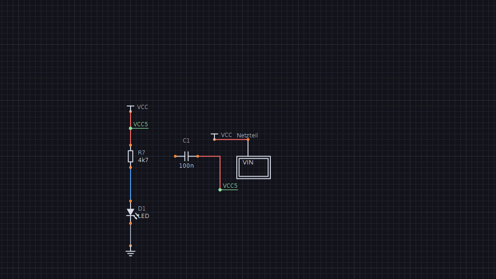

**Busse** (Knopf „Bus", Taste `B`): gezeichnet wie ein Draht, nur dick, und
mit einem Namen, der die Mitglieder nennt – `D[0..7]` (D0 … D7), `A[15:0]`
(A15 … A0), Listen wie `D[0..3],CLK EN` und KiCad-Gruppen `I2C{SDA SCL}`
(I2C.SDA, I2C.SCL). Ein Bus **verbindet nichts**: verbunden wird wie überall
über Netznamen. Ein Draht, der auf dem Bus endet, ist ein **Abzweig** –
Funkenflug fragt nach dem Mitglied (das nächste freie steht schon da) und
setzt das Label einen Rasterschritt neben den Bus auf den Draht; Draht und
Label sind ein Rückgängig-Schritt. Busse wählt, zieht, dreht, löscht und
kopiert man wie Drähte, die Abzweige folgen beim Ziehen und Drehen; ein
Doppelklick benennt um. Busse, die sich berühren, sind eine Gruppe mit einem
Namen (ein neuer Bus an einem benannten fragt nicht nach).

Der ERC prüft das Bild: Abzweig ohne Label („welches Mitglied?"), ein Label,
das nicht zum Bus gehört, ein Pin direkt auf dem Bus, ein Bus ohne oder mit
unlesbarem Namen, zusammenhängende Busse mit zwei Namen. Über die
Blattgrenze: ein hierarchisches Label `D[0..7]` im Unterblatt gibt einen
**Bus-Port**, der jedes Mitglied mit dem gleichnamigen Netz im Elternblatt
verbindet.

SparkNode führte den Bus als Art von Draht in derselben Verbindungsrechnung
(und brauchte Ausnahmen, damit er nicht alle Mitglieder kurzschließt); die
Netzliste kannte Busse gar nicht. Hier liegen Busse in einer eigenen Liste
und kommen in der Netz-Erkennung nie vor.

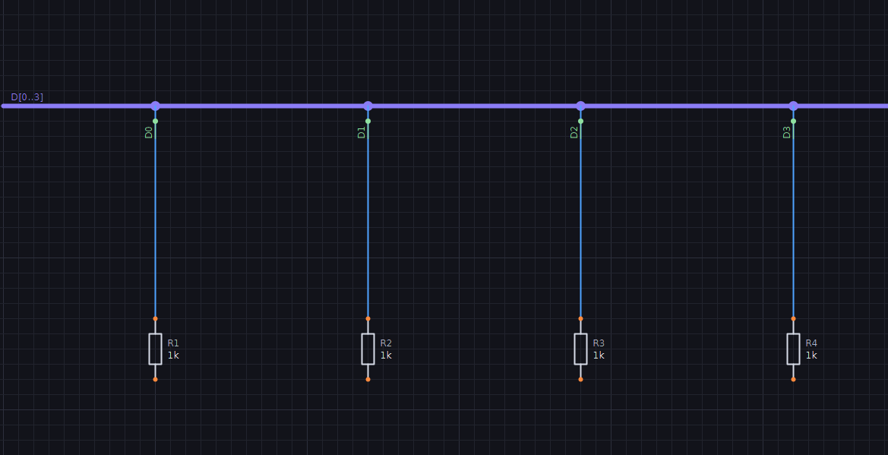

**Ausgabe** (Knopf „Ausgabe ▾" in der Kopfleiste): **PDF**, **SVG** und
**PNG** (150 dpi), **Drucken** über den Druckdialog des Systems, dazu
Stückliste und Netzliste. Alles läuft durch dieselbe Zeichenroutine wie der
Bildschirm, nur mit Druckfarben auf Weiß, ohne Raster, Auswahl und Pin-Punkte,
auf A4 quer eingepasst (kleine Schaltungen höchstens 3:1) und mit Schriftfeld.
PDF und Druck haben **eine Seite je Blatt** („Blatt: Takt (2 von 3)"), SVG und
PNG zeigen das aktuelle Blatt.


**Projektbericht** („Ausgabe ▾" → „Projektbericht (PDF)"): ein PDF mit
allem – Deckblatt (Titel, Firma, Autor, Revision, Datum, Datei; Blätter mit
Pfad, Bauteile, Netze, ERC-Stand, Platinen-Stand; Inhaltsverzeichnis mit
Seitenzahlen), jedes Schaltplanblatt, Stückliste mit den gewählten Spalten,
Netzliste, ERC-Liste (Fehler rot) und – wenn Teile darauf stecken – die
Platine 1:1 (Bestückung, Lötseite, Arbeitsliste). Gezeichnet wird mit
denselben Routinen wie Export und Druck; jede Seite trägt unten Titel,
Abschnitt und „Seite i von n".

**Eigene Bauteile und ICs** (Knopf „Symbol …" in der Leiste; ist ein eigenes
Bauteil gewählt, bearbeitet er dessen Symbol): Name, Präfix, Wert und eine
**Pinliste**, eine Zeile je Pin –

```
# Nummer  Name   Seite   Typ
1  GND    unten   vin
2  TRIG   links   ein
3  OUT    rechts  aus
8  VCC    oben    vin
```

Seite: `links rechts oben unten` (Vorgabe links), Typ: `passiv ein aus bidir
vin vout nc` (Vorgabe passiv). Fehler stehen zeilengenau unter der Liste,
rechts zeigt eine Vorschau das Symbol, genau wie es im Schaltplan erscheint.
Gehäuse und Pins legt der Generator rasterfest an, Pin-Nummern und -Namen
werden mitgezeichnet. Die Pin-Typen gehen in den ERC (Eingang ohne Treiber,
Ausgänge gegeneinander …).


**Freie Grafik:** In dieselbe Liste dürfen Zeichenbefehle (Maße in mm, Komma
oder Punkt, y nach unten, 0/0 = Bauteil-Ursprung):

```
linie    -2 -3  3 0  -2 3  -2 -3     # Polylinie, "voll" am Ende füllt
rechteck x1 y1 x2 y2 [voll]
kreis    3,5 0 0,5 [voll]
bogen    0 0 4 0 90                  # Mitte, Radius, Winkel (Grad, im Uhrzeigersinn)
text     0 -4 ~{EN}
pin 1 IN-  -5 -1 links ein           # Nummer Name x y Seite [Typ] [Länge]
pin 3 OUT   6  0 rechts aus 2
```

Ein `pin` sitzt mit seinem elektrischen Punkt auf (x, y) – der muss auf dem
1-mm-Raster liegen, sonst ließe er sich nicht anschließen; die Seite sagt,
wohin er absteht. Gibt es Seiten-Pins, baut der Generator sein Rechteck und
die Grafik kommt dazu (Logo, Innenleben); ohne Seiten-Pins ist das Symbol ganz
frei. Frei gesetzte Pins zeigen ihre Nummer, den Namen nicht (er gilt weiter
für ERC und Netzliste). Text-Elemente bleiben beim Drehen aufrecht.


**Mit der Maus zeichnen:** Über der Vorschau liegen die Werkzeuge *Linie*
(Punkte klicken, Doppelklick oder rechte Taste beendet), *Rechteck* und
*Kreis* (aufziehen), *Bogen* (Mitte, Anfang, Ende klicken – im
Uhrzeigersinn, Winkel auf 5°), *Text* (Stelle klicken, Inhalt eingeben),
*Pin* (Anschlusspunkt klicken; er steht von der Grafik weg nach außen, die
Nummer ist die nächste freie), *Verschieben* (Element anfassen und ziehen –
versetzt nur die Zahlen seiner Zeile, alles andere bleibt, wie es
geschrieben war) und *Löschen* (Element anklicken). Alles läuft auf dem 0,5-mm-Raster, Pins auf 1 mm; beim Zeichnen
zeigt die Vorschau Rasterpunkte und den Ursprung, der Ausschnitt bleibt
stehen, solange alles hineinpasst. Der Text bleibt dabei die einzige Quelle:
jeder Strich wird eine Zeile (`rechteck -4 -3 4 3`), Löschen streicht die
Zeile des angeklickten Elements – man kann zeichnen und tippen mischen.
*Rückgängig* nimmt die letzte gezeichnete Änderung zurück.

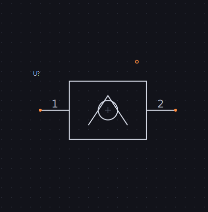

Eigene Symbole **stecken in der `.fkn`** – eine Datei bleibt eigenständig,
auch auf einem anderen Rechner. Mit dem Haken „auch in meiner Bibliothek
speichern" landen sie zusätzlich in `%APPDATA%\Funkenflug\symbole.fkl`
(Linux: `~/.config/funkenflug/`, abweichend per `FUNKENFLUG_BIBLIOTHEK`) und
stehen in jedem Projekt in der Bauteilliste. Ein Symbol bearbeiten ändert alle
Bauteile, die es benutzen – ein Rückgängig-Schritt. Fehlt ein Symbol wirklich,
erscheint ein roter Platzhalter, und der ERC meldet es.

**Stückliste** (Kopfleiste): gruppiert nach Bauteil, Wert, Gehäuse und
Bestellnummer (10k in 0805 und in 1206 sind zwei Positionen), natürlich
sortiert (R2 vor R10), Bereiche zusammengefasst (`R1-R3, R10`), ohne
Versorgungssymbole; Export als CSV (Semikolon), Markdown oder Text. Welche
**Spalten** – Menge, Referenzen, Wert, Bauteil, Gehäuse, Bestellnummer,
Bauform, Beschreibung – setzt man per Haken über der Vorschau; Vorschau und
Export folgen ihnen (Vorgabe: die ersten vier, Gehäuse und Bestellnummer nur,
wenn eine Position sie hat). In CSV stehen die Referenzen einzeln, in Markdown
und Text als Bereiche.

**Ablage:** `Strg+C` kopiert, `Strg+X` schneidet aus, `Strg+V` fügt an der
Mausposition ein, `Strg+A` wählt alles. Das läuft über die Zwischenablage des
Systems, also auch zwischen zwei Funkenflug-Fenstern. Eingefügte Bauteile
bekommen freie Referenzen (eine Kopie von R1 wird z. B. R8), Labels und
Versorgungen behalten ihre Namen und hängen damit am selben Netz wie das
Original. Das Eingefügte ist danach gewählt und lässt sich gleich verschieben.

**Drähte:** Ein Klick wählt das Segment unter der Maus. Ziehen verschiebt nur
dieses Segment – waagrechte senkrecht, senkrechte waagrecht, damit die Nachbarn
rechtwinklig bleiben. Hängt an einem Drahtende etwas (Pin, Label, anderer
Draht), bleibt das Ende stehen und ein Verbindungsknick entsteht: Ziehen reißt
keine Verbindung ab. Danach räumt Funkenflug den Draht auf (Ecken auf einer
Geraden fallen weg). `Entf` löscht das Segment, der Draht zerfällt in die
Reststücke; `Umschalt+Entf` löscht den ganzen Draht.

**Umbenennen** (`F2`, oder Doppelklick auf Label/Draht): Ein Netzname wird an
**allen Stellen** ersetzt – gleichnamige Labels und Versorgungssymbole (aus GND
wird so z. B. `AGND`, es bleibt trotzdem SPICE-Masse). Bei einem Label lässt
ein Haken auch nur dieses eine umbenennen. Hat das Netz nur einen automatischen
Namen, setzt Funkenflug ein Label an die angeklickte Stelle. Trägt ein anderes
Netz den neuen Namen schon, fragt es vorher – Umbenennen würde beide verbinden.

**Drahtfarben:** Versorgungsnetze rot (VCC, VDD, +5V, 3V3 …), Masse grau (GND,
AGND, VSS, 0V …), Signale blau – nach Versorgungssymbol bzw. Netzname, im
Druck in dunkleren Tönen.

**Netze:** Fährt die Maus über einen Draht, einen Pin oder ein Label, zeigt die
Statuszeile den Netznamen samt Pinzahl und die Drähte des Netzes leuchten auf.
Namen: Versorgungssymbol (GND, VCC, auch ein umbenanntes wie `+5V`) vor globalem
vor lokalem Label vor automatisch (`N1`, `N2` …). Gleichnamige Versorgungen und Labels sind ein Netz,
auch ohne Draht.

**ERC** (Kopfleiste): listet Fehler und Warnungen in einem Fenster, das offen
bleiben darf; eine Zeile anklicken holt die Stelle in die Mitte, auf der Fläche
markieren Kreise jede Stelle. Geprüft werden doppelte und fehlende Referenzen,
offene Pins, offene Drahtenden, kurzgeschlossene Bauteile (zwei Pins im selben
Netz), mehrere Labels an einem Netz, Labels auf einer fremden Versorgung,
**Kurzschlüsse zwischen Versorgungen** und die Pin-Typen gegeneinander (zwei
Ausgänge, Ausgang gegen Versorgung, Eingang ohne Treiber …), dazu globale Labels,
die es nur einmal gibt (sie verbinden nichts). Versorgungssymbole
gelten als Quelle – ein PWR_FLAG wie in KiCad braucht es nicht.

**Netzliste** (Kopfleiste): das Format folgt der Endung – `.cir`/`.sp` SPICE
(direkt für ngspice: GND wird Knoten `0`, `4k7` → `4.7k`, `1M` → `1Meg`, denn
`M` heißt in SPICE *milli*; dieselben Elemente, Quellen und Modelle wie die
[Simulation](#simulation-ngspice), Hinweise als Kommentar),
`.csv` (Semikolon), `.txt` als lesbarer Text oder **`.net` für KiCad**
(S-Ausdruck, in Pcbnew per „Netzliste importieren"). Die KiCad-Netzliste
schlägt je Bauteil einen Footprint aus der Bauform vor (AX4 →
`R_Axial_…_P10.16mm`, RAD2 → `C_Disc_…_P5.00mm`, DIP8 → `DIP-8_W7.62mm`,
TO92 → `TO-92_Inline`, SILn/HDR → `PinHeader_…`); was sich nicht sicher
zuordnen lässt, bleibt leer. Jeder Knoten nennt die **Pad-Nummer der
Bauform**, nicht die Pin-Nummer des Symbols – sonst läge beim TO-92 (C B E)
in KiCad die Basis (Funkenflug-Pin 1) auf dem Kollektor-Pad. Titel, Revision,
Bestellnummer reisen mit. (`.net` war früher die Text-Netzliste.)

## Bibliothek

37 eingebaute Symbole, jedes mit seiner Platinen-Bauform:

| Gruppe | Symbole (Vorgabe-Bauform) |
|---|---|
| Passive | Widerstand (AX4), Kondensator (RAD2), Elko (RAD1), Spule (AX4), Potentiometer (TRIM), Quarz (RAD2), Sicherung (AX9, Halter 5×20) |
| Dioden | Diode, Z-Diode, Schottky (AX4), LED (RAD1) |
| Transistoren | NPN BC547, PNP BC557 (TO92-CBE), N-MOSFET 2N7000, P-MOSFET BS250 (TO92-SGD) |
| Analog | Operationsverstärker (DIP8, Pins wie TL071/741), Spannungsregler 78xx (TO220: IN GND OUT), Timer 555 (DIP8) |
| Logik | 7400, 7404, 7408, 7432, 7486 als ganze ICs (DIP14) |
| Schalter | Schalter (RAD2), Taster (TAST6: 6×6, je zwei Beine intern verbunden), Relais mit Wechsler (RELAIS5) |
| Anschlüsse | Stecker 1×2, 1×3, 1×4, 1×6, 1×8 (SIL), 2×5 (HDR2X5), Batterie (RAD4) |
| Versorgung | GND, VCC |
| Simulation | Spannungsquelle, Signalquelle (nicht auf Platine und Stückliste) |

Logik gibt es bewusst als ganze 74xx-ICs: einzelne Gatter-Symbole bräuchten
Mehrfach-Einheiten je Gehäuse. Die Beinfolge der Transistoren hängt vom Typ
ab – passt sie nicht, das Gehäuse-Feld ändern (`TO92-EBC`, `TO92-GDS` …).
`RELAIS5` ist der verbreiteten Songle-SRD-Reihe angenähert; vor dem Bohren
am Datenblatt prüfen. Ein Test geht die ganze Bibliothek durch: jeder
Anschluss auf dem 1-mm-Raster (beim alten NPN lagen Kollektor und Emitter
0,7 mm daneben – verbunden war es nur, weil die Netz-Erkennung rundet),
Pin-Nummern eindeutig, jedes Bein in der Bauform vorhanden.

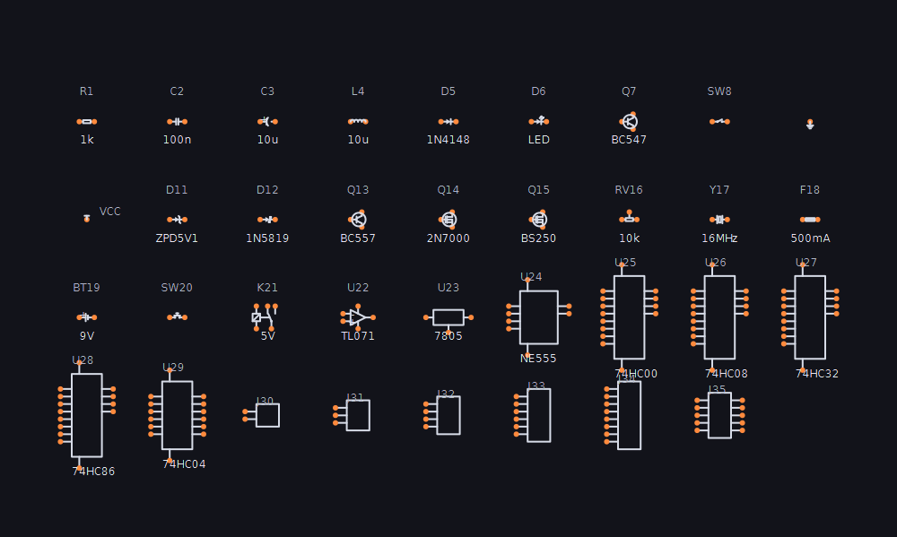

## Platine (Lochraster / Streifenraster)

„Platine" in der Kopfleiste schaltet auf die Lochraster-Sicht desselben
Dokuments (eigener Ausschnitt, eigene Werkzeugleiste). Welche Pins
zusammengehören, sagt **allein der Schaltplan**; die Platine sagt nur, wo die
Teile stecken und wie das Kupfer verbunden ist. Die Prüfung vergleicht beides
laufend:

- **Luftlinien** (gelb): im Schaltplan verbunden, auf der Platine noch nicht –
  je Netz die kürzesten Strecken zwischen den Kupfer-Inseln.
- **Kurzschluss** (rot): zwei Netze auf demselben Kupferstück.
- **Hinweise** (orange): doppelt belegtes Loch, Bein außerhalb der Platine, Bein
  in einer Trennstelle, unbekanntes Gehäuse.

**Cross-Probing:** Die Auswahl wandert beim Umschalten mit – gewählte
Bauteile im Schaltplan sind auf der Platine gewählt und umgekehrt (im
Schaltplan samt Blattwechsel und Sprung). Steckt ein Teil noch nicht auf der
Platine, sagt es die Statuszeile.

`ERC` heißt in dieser Sicht „Platine prüfen" und listet alles; eine Zeile
springt hin. Die Statuszeile nennt das Netz des Lochs unter der Maus.

| Werkzeug | |
|---|---|
| **Auswahl** (`A`) | Teil ziehen (lochweise), `R` dreht – am Rand rückt es ein, statt still abgelehnt zu werden –, `Entf` nimmt es herunter; eine Bahn anklicken und `Entf` löscht sie. Ein **Rahmen** über leerer Fläche wählt alle Teile darin, `Umschalt` nimmt einzelne dazu oder heraus, `Strg+A` alle; ein Klick in die Auswahl zieht die ganze Gruppe; `R` dreht eine Gruppe als Ganzes um ihre Mitte (ragt sie danach über den Rand, rückt sie gemeinsam ein), `Entf` nimmt alle herunter. Trennstellen und Brücken gehören zur Platine und drehen nicht mit – die Prüfung zeigt, was danach nicht mehr passt |
| **Bahn** (`B`) | Loch für Loch klicken, rechte Taste beendet. Auf Lochraster ist eine gerade Bahn eine **Lötbahn** (verbindet jedes Loch auf ihrem Weg), sonst – und immer auf Streifenraster – eine **Drahtbrücke** (nur ihre Enden); `Umschalt` erzwingt die Brücke |
| **Trennen** (`T`) | Streifen an einem Loch auftrennen bzw. wieder schließen |

**Verbinden** (`V`) legt für alle Luftlinien einen Vorschlag – auf
Streifenraster eine Drahtbrücke zwischen freien Löchern der beiden
Kupferstücke (gerade, wo eine gemeinsame Spalte frei ist, sonst die kürzeste),
auf Lochraster Lötbahnen auf dem kürzesten Weg über freie Löcher. Jeder
Vorschlag wird sofort geprüft: was einen Kurzschluss gäbe oder nichts hilft,
fliegt wieder raus; was keinen Weg findet, bleibt Luftlinie. Alles zusammen
ist ein Rückgängig-Schritt. Kein Autorouter, der still Platz verbraucht –
jede Brücke steht danach in der Arbeitsliste.

**Einsetzen** setzt alle Teile, die noch fehlen – **nach Netzen**: zuerst das
Teil mit den meisten Verbindungen, dann immer das, das am meisten mit schon
Gesetztem teilt, dorthin, wo seine Beine den gesetzten Beinen derselben Netze
am nächsten sind (auf Lochraster quer oder längs, was kürzer ist). Eine Kette
aus sechs Widerständen, im Schaltplan durcheinander, braucht so 19 statt 44
Löcher Luftlinie (Lochraster: 17 statt 62). Auf Streifenraster stehen sie
quer zu den Streifen (sonst lägen beide Beine eines Widerstands auf einem
Streifen), rechts neben jedem Teil und unter einem DIP zwischen den Reihen
wird getrennt (allgemein: in jeder Zeile zwischen zwei Beinen verschiedener
Pins, die Drehung mit den wenigsten Trennstellen gewinnt – das deckt DIP,
Relais und Taster ohne Sonderregel), und rechts bleibt ein freies Loch, damit jedes Teil auf seinem
Streifenstück Platz für eine Brücke hat – es entsteht nie ein Kurzschluss,
was fehlt, zeigen die Luftlinien. Bauteile, die im Schaltplan gelöscht wurden, verschwinden beim
Umschalten von der Platine (ein Rückgängig-Schritt).

Die **Bauform** ist das Gehäuse-Feld des Bauteils: `AX4` (axial, 4 Löcher),
`RAD2`, `RAD1`, `TO92-CBE` (Beinfolge nach Pin-Namen, auch `TO92-GDS` für FETs),
`TO220-GDS`, `TO92`/`TO220` ohne Folge (Pins 1 2 3), `DIP8`, `SIL3`, `HDR2X5`
(Stiftleiste 2 × 5, Pin 1 und 2 nebeneinander), `TRIM` (stehender Trimmer),
`TAST6` (6×6-Taster), `RELAIS5`. Mehrere Beine mit demselben Schlüssel
gehören zum selben Pin – jedes bekommt ein Lötauge im selben Netz (so steht
ein Tasterbein nie unbemerkt auf einem fremden Streifen).
Eigene Symbole bringen ihre Bauform in der Pinliste mit: `bauform DIP8` als
Vorgabe oder ganz eigen je Pin `loch Nr Spalte Zeile` (z. B. ein Relais mit
versetzten Beinen); der Editor meldet fehlende, doppelte und unbekannte
Löcher zeilengenau. Ein Gehäuse am Bauteil geht immer vor. Ohne
Angabe gilt eine Vorgabe je Symbol (Widerstand/Diode AX4, Kondensator RAD2,
Elko/LED RAD1, NPN TO92-CBE, eigene ICs DIP bzw. SIL). Platine, Teile, Bahnen
und Trennstellen stecken in der `.fkn` und im Rückgängig.


**Ausgabe** (Menü „Ausgabe ▾" → „Platine als PDF (1:1)" bzw. „Platine drucken
(1:1)"): drei Teile – **Bestückungsseite** (von oben: Umriss und Referenz je
Teil, Pin 1 eckig, Brücken blau), **Lötseite** (von unten, links/rechts
gespiegelt: Streifen, rote Kreuze an den Trennstellen, Lötbahnen, Brücken-
Enden) und die **Arbeitsliste** (Trennstellen, Brücken mit Drahtlänge in mm,
Bauteile mit Wert, Bauform und Loch von Bein 1). Gerechnet wird 1:1 – ein Loch
sind 2,54 mm, der Ausdruck passt auf die Platine. Die Spalten-Nummern am Rand
sind auf beiden Seiten die der Bestückungsseite, damit die Liste überall
stimmt. Jede Seite hat einen 10-mm-Balken zum Nachmessen; stellt der
Druckdialog „an Seite anpassen" ein, sieht man es dort. Passt eine große
Platine nicht auf A4, wird verkleinert, und der Kopf sagt es rot. Der Kopf
nennt auch den Prüfstand (offene Verbindungen, Kurzschlüsse).

**3D** (Knopf „3D" in der Platinen-Leiste): die bestückte Platine in einem
eigenen Fenster – ziehen dreht (waagrecht um die Hochachse, senkrecht kippen
bis unter die Platte), das Mausrad zoomt, Knöpfe für *von oben*, *Lötseite*
(von unten, links/rechts gespiegelt wie im Ausdruck) und *schräg*. Jede
Bauform hat ihre Gestalt: Widerstände mit **Farbringen nach dem Wert**
(4k7 = gelb-violett-rot-gold), Dioden mit Kathodenring, Elko mit Deckel,
LED in der Farbe aus ihrem Wert, Keramik-Scheibe, Quarz, TO-92 mit flacher
Seite, TO-220 mit Kühlfahne, DIP mit Kerbe an Pin 1, Stiftleisten,
Trimmer, Taster, Relais; Drahtbrücken als Drähte. Unten Streifen bzw.
Lötaugen, Trennstellen als Lücken, Lötbahnen und Lötpunkte an den benutzten
Löchern.

Gezeichnet wird mit Cairo, ohne OpenGL: Rückseiten fallen weg, Platte und
Aufdrucke kommen als Schichten, die Körper werden **je Fläche** nach Tiefe
sortiert (SparkNode hatte eine feste isometrische Sicht und sortierte je
Bauteil – Nachbarn lagen dann falsch übereinander). Ein Bild braucht rund
15 ms.

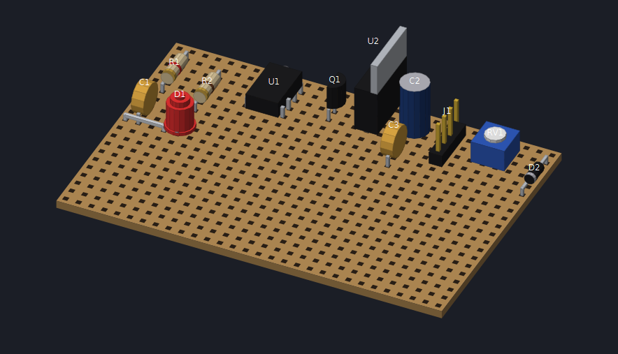

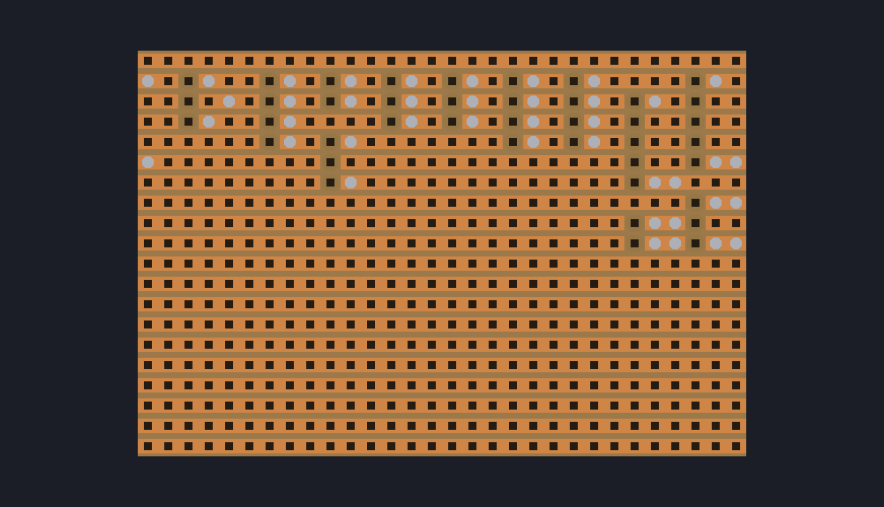

**Gerber für den Fertiger** („Ausgabe ▾" → „Platine als Gerber (ZIP)"): aus
dem Raster-Aufbau wird eine zweilagige Leiterplatte im 2,54-mm-Raster, die
**genau so verbindet** wie die Lochraster-/Streifenplatine – ein ZIP mit
Kupfer oben/unten, Lötstopp oben/unten, Bestückungsdruck, Umriss, Bohrdatei
(Excellon) und `LIESMICH.txt`. Gerber X2: die Dateien sagen selbst, welche
Lage sie sind, der Fertiger ordnet sie ohne Nachfragen zu.

- Gebohrt wird nur, wo etwas steckt (Beine, Brückenenden); TO-220, Relais
  und Taster bekommen größere Bohrungen.
- Ein **Streifen** wird zur Leiterbahn zwischen seinem ersten und letzten
  benutzten Loch, an jeder Trennstelle unterbrochen; Lötbahnen werden Bahnen
  unten. **Drahtbrücken** bleiben Drähte (Bohrungen plus Linie im
  Bestückungsdruck) – als Kupfer oben liefen sie über fremde Lötaugen.
- Die Platine wird auf den **benutzten Bereich zugeschnitten** (gezahlt wird
  die Fläche), mit 3,81 mm Rand für Referenzen und Titel.
- Bestückungsdruck mit Umriss je Teil, Pin-1-Punkt und den **Referenzen in
  einer eigenen Strichschrift** (SparkNode setzte nur einen Punkt an Pin 1,
  „Text in Gerber ist aufwendig").
- Offene Luftlinien, Kurzschlüsse und nicht gesetzte Teile stehen als
  ACHTUNG im LIESMICH und im Dialog – exportiert wird trotzdem.

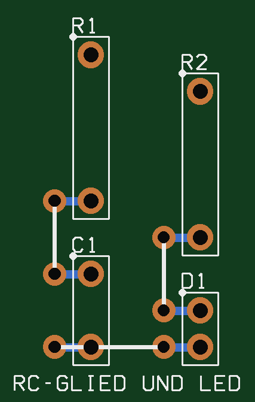

`daten/gerber_pruefen.py` prüft einen Satz **unabhängig** von Funkenflug:
liest Gerber und Excellon, rechnet aus der Geometrie (sich berührende Augen
und Bahnen, Durchkontaktierung, Brücken) die Kupferinseln aus und vergleicht
sie mit den Netzen – nichts zerfällt, nichts ist kurzgeschlossen, jedes Bein
gebohrt mit Auge oben und unten, Restring und Randabstand passen. Mit
absichtlich beschädigten Sätzen meldet er die fehlenden Bahnen bzw. den
Kurzschluss.

## Datei und Bearbeiten

**Datei ▾**: „Speichern unter …" und die acht zuletzt geöffneten Dateien.
**Autosave**: jede Minute, wenn sich etwas geändert hat, nach
`<Datei>.sicherung` (ein Schaltplan ohne Namen nach
`unbenannt.sicherung.fkn` im Einstellungs-Ordner). Speichern löscht die
Sicherung. Findet Funkenflug beim Öffnen eine Sicherung, die nicht älter ist
als die Datei, fragt es, ob sie geladen werden soll – die Datei selbst bleibt
dabei unverändert, erst Speichern übernimmt die Sicherung. Nach einem Absturz
geht so höchstens eine Minute Arbeit verloren.

**Bearbeiten ▾**:

- *Fehlende Referenzen vergeben* – jede gültige, eindeutige Referenz bleibt,
  leere und doppelte bekommen die nächste freie Nummer, in Leserichtung.
- *Alle neu annotieren* – Blatt für Blatt, zeilenweise von oben links (in
  5-mm-Bändern, damit eine leicht versetzte Reihe zusammenbleibt); fragt
  vorher, weil danach Bestückungsliste und Platine andere Namen tragen.
- *Suchen & Ersetzen* (`Strg+F`) – in Referenzen, Werten und Labels über alle
  Blätter, mit oder ohne Groß/Klein; die Liste folgt jeder Eingabe, eine Zeile
  springt aufs Blatt und wählt das Element, *Alle ersetzen* ist ein
  Rückgängig-Schritt. Ein Feld ist ein Treffer, auch wenn das Muster darin
  mehrmals vorkommt.
- *Ausrichten / Verteilen* – gewählte Bauteile links, rechts, oben oder unten
  an der Kante der Auswahl ausrichten bzw. ihre Mitten waagrecht oder
  senkrecht gleichmäßig verteilen (die äußeren bleiben stehen). Alles auf dem
  1-mm-Raster, angeschlossene Drähte folgen mit dem Gummiband.
- *Dokument-Eigenschaften* – Titel, Autor, Revision, Firma/Projekt fürs
  Schriftfeld (PDF, Druck) und den Kopf des Platinen-Ausdrucks.

Alles, was hinterher erst weiß, ob es etwas geändert hat (Annotieren,
Ersetzen, Verbinden), legt nur dann einen Rückgängig-Schritt an.

## KiCad-Schaltplan öffnen

„Öffnen" nimmt auch **`.kicad_sch`** (KiCad 6, 7, 8). Daraus wird ein neues,
ungespeichertes Dokument; „Speichern" schlägt `<name>.fkn` vor, die KiCad-Datei
bleibt unberührt. Übernommen werden:

- **Symbole** aus `lib_symbols` mit Grafik (Linie, Polylinie, Rechteck, Kreis,
  Bogen, Text), Pins samt Typ, Name, Nummer und Versteck-Schaltern. Sie werden
  eigene Symbole (`kicad:Device:R`), reisen in der `.fkn` mit und stehen in der
  Bauteilliste. **Versorgungssymbole** (`power:GND`) werden Versorgungen.
- **Bauteile** mit Lage (alle acht), Referenz (auch aus den Instanz-Pfaden),
  Wert, Textpositionen, Bestellnummer (MPN, LCSC …). Der **Footprint** wird zur
  Bauform, wo sie sich sicher ablesen lässt (`DIP-14_W7.62mm` → DIP14,
  `TO-92_Inline` → TO92, `R_Axial…P10.16mm` → AX4, `PinHeader_1x04` → SIL4);
  sonst steht sein Name im Gehäuse-Feld. Mehrteilige Symbole werden je Einheit
  ein Bauteil (U1A, U1B).
- **Drähte, Verbindungspunkte, Labels** (lokal, global, hierarchisch) und
  **Unterblätter** – jede Unterblatt-Datei wird ein Blatt mit Blattsymbol. Weil
  das Blattsymbol aus den Labels entsteht und seine eigene Größe hat, hängen
  seine Ports über ein Label-Paar an den alten KiCad-Anschlüssen (keine Drähte
  quer übers Symbol, die etwas berühren könnten).
- **Titel, Revision, Firma** und das Papierformat.

**Maßstab:** 1,27 mm (das KiCad-Raster) wird 1 mm (das Funkenflug-Raster). So
liegt jeder Pin auf dem Raster, auf dem Netze verknüpft und Teile gezogen
werden; ein KiCad-Widerstand wird genau so lang wie der eigene. SparkNode
rechnete 1:1 in mm und landete mit den Pins neben dem Raster.

**Lage:** KiCad-Symbole haben Y nach oben, KiCad dreht gegen den Uhrzeigersinn
und spiegelt *nach* dem Drehen („mirror x" = oben/unten). Funkenflug dreht im
Uhrzeigersinn und spiegelt links/rechts. Die Umrechnung (`mirror x` = links/
rechts + 180°) prüft `pruef_kern.dh` an einer Testdatei mit allen acht Lagen:
jeder Pin muss auf dem Drahtende liegen, das mit KiCads eigener
Transform-Rechnung erzeugt wurde (`daten/kicad/erzeugen.py`).

**Busse** kommen mit: das Label auf dem Bus wird sein Name, jeder
Bus-Eintrag (der Schrägstrich) ein Draht, der auf dem Bus endet – also ein
Abzweig mit dem Label seines Drahts.

Was Funkenflug nicht kennt, wird **gemeldet** statt still verworfen (ein Dialog
nach dem Öffnen): Bus-Aliase, freie Texte und Zeichnungen auf dem Blatt,
Nicht-verbunden-Marker, mehrfach eingesetzte Unterblätter. **Versteckte
Versorgungs-Pins** (VCC/GND an 74xx-Symbolen) verbinden in KiCad unsichtbar
über ihren Namen – hier bekommen sie ein sichtbares globales Label, das Netz
bleibt dasselbe.

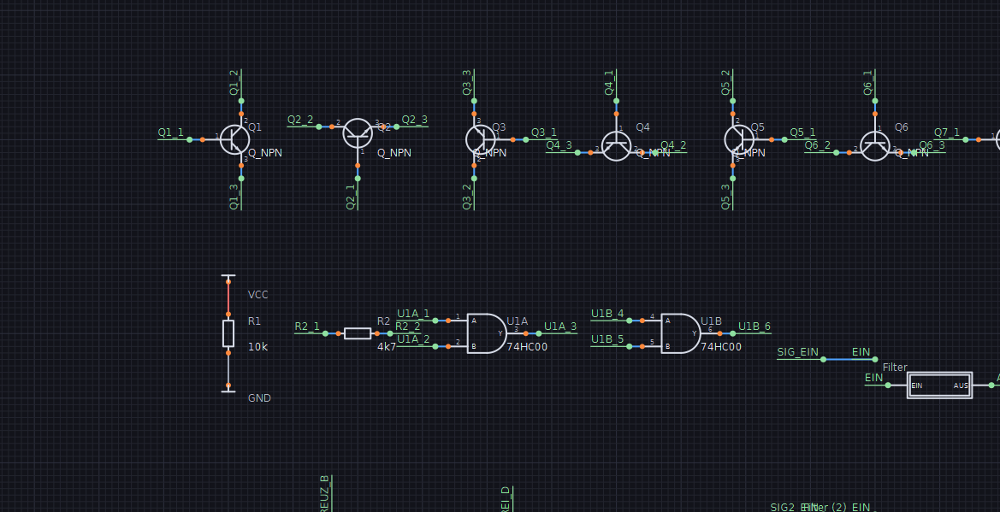

## Simulation (ngspice)

„Simulation ▾" in der Kopfleiste rechnet den Schaltplan mit **ngspice** – als
Bibliothek per FFI geladen (`ngspice.dll` / `libngspice.so`), die Schaltung
geht als Zeilen hinein, die Ergebnisse kommen als Zahlenfelder zurück, ohne
Zwischendateien. Gesucht wird in `FUNKENFLUG_NGSPICE`, dann an den üblichen
Orten (`C:\Spice64_dll\dll-vs`, `/usr/lib/…/libngspice.so.0`, Homebrew);
fehlt sie, fragt Funkenflug einmal nach dem Pfad und merkt ihn sich. Ohne
ngspice läuft alles andere wie bisher.

- **Arbeitspunkt** – die Spannung jedes Netzes steht als gelbe Marke im
  Schaltplan und hinter dem Netznamen in der Statuszeile (Maus über einem
  Draht); ein Fenster listet alle Netze und was jede Quelle liefert. Jede
  Änderung am Schaltplan nimmt die Marken weg – alte Werte stehen nie neben
  einer geänderten Schaltung.
- **Zeitverlauf** (Dauer, Schritt) und **Frequenzgang** (von/bis, Punkte je
  Dekade; Betrag in dB, logarithmische Achse) – Kurven in einem eigenen
  Fenster, ein Haken je Netz, die Maus liest Zeit/Frequenz und alle Werte ab
  (im Frequenzgang mit Phase). Vorgewählt sind die Netze mit Label-Namen.

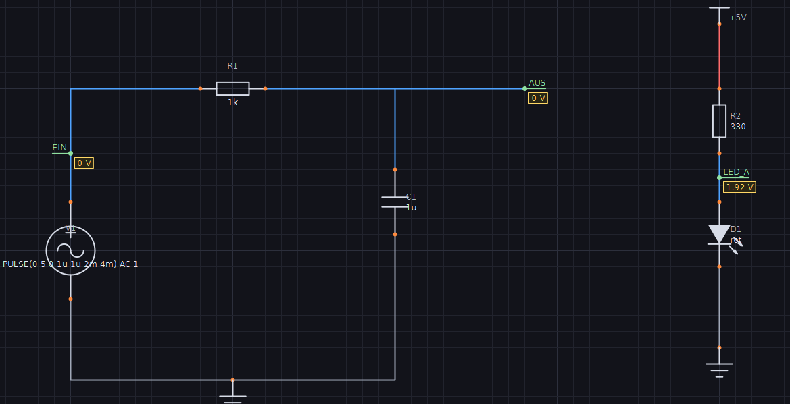

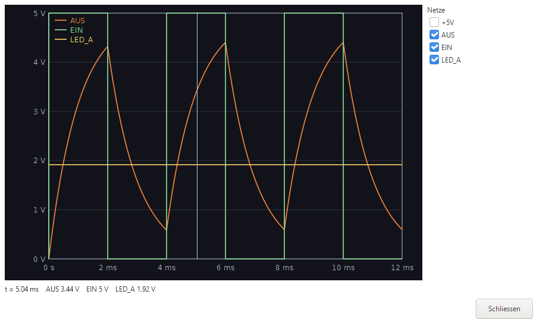

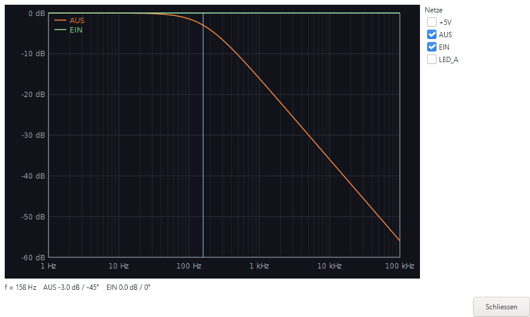

Was ein Schaltplan nicht sagt, ergänzt Funkenflug – und **meldet es**
(SparkNode warf Teile ohne Modell still heraus):

| Im Schaltplan | in der Simulation |
|---|---|
| Versorgungssymbol | Spannungsquelle gegen Masse; Spannung aus dem Namen (`+5V`, `3V3`, `-12V`), ohne Zahl (`VCC`) die Einstellung im Dialog |
| Spannungs-/Signalquelle, Batterie | Wert in SPICE-Schreibweise: `5V`, `SIN(0 1 1k) AC 1`, `PULSE(0 5 0 1u 1u 2m 4m)` |
| Diode, LED, Z-, Schottky-Diode | Modell nach Wert (1N4148, 1N400x, 1N58xx, BAT…); LED nach Farbe im Wert (rot 1,9 V, grün 2,1 V, blau/weiß 3 V); Z-Spannung aus `ZPD5V1`, `BZX55C12` |
| NPN, PNP, MOSFET | BC54x/BC55x, 2N3904/3906, 2N2222/2907, BC33x/32x, 2N7000/BS170, BS250, IRF/IRL; sonst ein typisches Modell |
| OPV | ideal (Verstärkung 10⁵), Ausgang weich an seiner Versorgung begrenzt (ohne Versorgung ±15 V) |
| Regler 78xx/79xx | idealer Regler (2 V Abfall) |
| Poti, Sicherung, Schalter, Relais | Schleifer in der Mitte; 10 mΩ; offen (Wert `zu` schließt); unbestromt, Ruhekontakt zu |
| 555, 74xx, Quarz | ohne Modell weggelassen |

Eigene und aus KiCad importierte Symbole werden nach Vorsatz und Pin-Namen
erkannt (R/C/L, D mit A/K, Q mit B/C/E bzw. G/D/S). „SPICE-Deck anzeigen"
zeigt genau, was ngspice bekommt, samt Hinweisen. Gegen schwebende Knoten
(Kondensator in Reihe, weggelassenes IC) steht `rshunt=1e12` im Deck.

Gefunden beim Bau: Der SPICE-Export legte `+12V` und `-12V` auf **denselben**
Knoten `_12V` (beide Namen werden zu Knoten bereinigt) – die beiden
Versorgungen eines OPV waren damit kurzgeschlossen. Jedes Netz bekommt jetzt
einen eigenen Knoten (`-12V` → `M12V`).

## Aufbau

```
kern/       Modell, Geometrie, Bibliothek, Netze, Datei – ohne Oberfläche,
            Namensraum "kern"
  geometrie.dh   Punkt, Lage (Transform), Raster/Snap, Konstanten
  text.dh        Überstrich ~{RESET}: sichtbarer Text, Pango-Markup
  modell.dh      Pin, Primitiv, Symbol, Bauteil, Draht, Knoten, Label, Blatt, Dokument
  bibliothek.dh  Grundsymbole (R, C, Elko, L, Diode, LED, NPN, Schalter, GND, VCC)
  bibliothek_mehr.dh  weitere 25: Dioden, PNP/MOSFET, Poti, Quarz, Sicherung, OPV,
                 Regler, 555, 74xx, Stecker, Batterie, Taster, Relais
  netze.dh       Netz-Erkennung (eine reine Funktion), benannte Netze, Auto-Knoten
  erc.dh         Elektrische Regelpruefung
  hierarchie.dh  Unterblaetter: Blattsymbol aus den Labels, Ports, Pfad, ERC
  busse.dh       Busnamen und Mitglieder, Bus-Gruppen, Abzweige, Bus-Ports, ERC
  bearbeiten.dh  Annotieren, Suchen & Ersetzen
  netzliste.dh   Export: SPICE, CSV, Text
  ngspice.dh     ngspice als Bibliothek (FFI): laden, Schaltung rechnen, Vektoren lesen
  simulation.dh  Deck aus dem Schaltplan, Modelle, Quellen, Ergebnisse je Netz, SI-Zahlen
  kicad.dh       KiCad-Netzliste (.net) mit Footprint-Vorschlaegen und Pad-Nummern
  sausdruck.dh   S-Ausdruecke lesen (ohne Rekursion)
  kicadimport.dh KiCad-Schaltplan (.kicad_sch) einlesen: Symbole, Lagen, Unterblaetter
  gerber.dh      Gerber X2 + Excellon aus der Platine, Zuschnitt, Strichschrift
  platine3d.dh   3D-Modell der Platine (Bauformen, Farbringe), Kamera, Zeichenfolge
  symbole.dh     eigene Symbole: Pinliste, IC-Generator, JSON, Register, Bibliothek
  stueckliste.dh Stückliste: Gruppen, natürliche Sortierung, CSV/Markdown/Text
  platine.dh     Bauformen, Platinen-Pruefung (Inseln, Luftlinien, Kurzschluesse), Einsetzen
  datei.dh       Speichern/Laden als .fkn (JSON, Version 1)
gtk/        Deklarationen für GTK 3, GDK, Cairo, Pango, GLib (aus Glutfaden)
ansicht/    Zeichenfläche und Werkzeuge – globaler Namensraum
  leinwand.dh    Welt↔Schirm, Grid, Zeichnen von Bauteilen/Drähten/Knoten/Labels
  werkzeuge.dh   Maus, Tastatur, Werkzeug-Logik
  verlauf.dh     Rückgängig/Wiederholen
  auswahl.dh     Auswahl als Menge, Rahmen, Gruppen-Zug mit Gummiband, Ablage
  symboleditor.dh  Symbol-Editor mit Vorschau
  ausgabe.dh     PDF, SVG, PNG, Drucken, Menü „Ausgabe"
  blaetter.dh    Reiter, Menü „Blatt": neu, umbenennen, löschen
  busse.dh       Bus zeichnen und benennen, Abzweig mit Mitglieds-Label
  komfort.dh     Datei-Menü, zuletzt geöffnet, Autosave, Bearbeiten-Menü, Suchen-Dialog
  platinenansicht.dh  Lochraster-Sicht: Zeichnen, Werkzeuge, Pruefliste
  platinendruck.dh    Platine 1:1: Bestueckung, Loetseite, Arbeitsliste (PDF, Druck)
  bericht.dh     Projektbericht: Seitenplan, Deckblatt, Text-Seiten
  simulation.dh  Simulations-Menü, Spannungsmarken, Kurvenfenster mit Ablesen
  platine3d.dh   3D-Fenster: drehen, zoomen, oben/Lötseite/schräg
main.dh     Fenster, Kopfleiste, Werkzeugleiste, Statuszeile, Dialoge
```

Die Tests laufen ohne Mensch: `dhrt run funkenflug/pruef_kern.dh` prüft Modell,
Transform, Raster, Netze (auch T-Verbindung und Labels) und Save/Load.
`main.dh -- --foto bild.png` spielt die Werkzeuge durch – **samt der echten
Dialoge**, die ein Timer ausfüllt und bestätigt –, prüft Undo/Redo, gibt je
Prüfung `ok`/`FEHLER` aus und zeichnet das Fenster in eine PNG (312 Prüfungen,
darunter Drehen/Spiegeln einzeln und als Gruppe ohne Kurzschluss, PDF/SVG/PNG
und Drucken über GTKs Export-Weg, die echten Werkzeug-Knöpfe, Symbol-Editor,
Stückliste, Gummiband, Rahmen und Gruppen-Zug über den Klick-Handler,
Kopieren/Einfügen, Umbenennen, ERC und SPICE, mehrere Blätter mit Reitern,
globalem Label über den Dialog-Haken, ERC-Sprung aufs Blatt und mehrseitigem
PDF/Druck, gedrehte Labels samt Treffer-Test, Gehäuse/Bestellnummer einzeln
und für mehrere Bauteile, Referenz ziehen/drehen/zurücksetzen, frei
gezeichnetes Symbol platzieren und anschließen, Platine: umschalten,
einsetzen, Brücken entlang der Luftlinien klicken, trennen, ziehen, drehen am
Rand, Prüfliste, Art umschalten, Speichern, Verbinden, PDF/Druck der Platine
1:1, Gruppe drehen; im Symbol-Editor Rechteck, Linie, Kreis, Bogen, Text und
Pins mit Maus-Ereignissen zeichnen, verschieben, löschen, zurücknehmen und
übernehmen; Unterblatt über das Menü einsetzen, per Doppelklick öffnen, Port
mit `H`, Verbindung über die Blattgrenze; Annotieren über das Menü,
Suchen & Ersetzen im Dialog, Dokument-Eigenschaften, Speichern, Autosave und
Wiederherstellen beim Öffnen, Drahtfarben, Messen mit Fang, Verteilen und
Ausrichten samt Draht, Cross-Probing in beide Richtungen, KiCad-Schaltplan
öffnen, Simulation: Arbeitspunkt, Zeitverlauf und Frequenzgang über die echten
Dialoge samt Ablesen). Für die Simulationsschritte `FUNKENFLUG_NGSPICE` auf die
ngspice-Bibliothek setzen; fehlt sie, werden sie übersprungen. `pruef_kern.dh`
rechnet dann Teiler, LED, NPN-Schalter, OPV ×2 und übersteuert, RC-Sprung (τ),
RC-Tiefpass (−3 dB, −45°) und ein kaputtes Deck nach. Mit
`FUNKENFLUG_GERBER_ORDNER` schreibt `pruef_kern.dh` zwei Gerber-Sätze
(Lochraster, Streifenraster) samt erwarteten Netzen für `gerber_pruefen.py`. `pruef_kern.dh` prüft u. a. die
Gruppen-Lage in allen 8 Orientierungen × 3 Arten (72 Pin-Prüfungen). Der Selbsttest
lässt die Zwischenablage des Systems in Ruhe und schreibt seine Bibliothek in
eine Wegwerf-Datei neben dem Bild. `--nur-foto bild.png` macht nur das Bild.

## Was gegenüber SparkNode bewusst anders ist

SparkNode hatte mehrere Konzeptfehler, die hier von Anfang an vermieden sind:

1. **Eine Rotations-/Transform-Konvention für Modell UND Zeichnen.** In
   SparkNode drehte das Modell gegen, der Maler (`QPainter`) mit dem
   Uhrzeigersinn – gedrehte Pins lagen gespiegelt zu den elektrischen. Hier geht
   **alles** durch `kern.transformPunkt` / `kern.transformRichtung` (Y nach
   unten, Drehung im Uhrzeigersinn), und der Canvas baut seine Cairo-Matrix so
   auf, dass sie dieselbe Rechnung ist. Gezeichnet == elektrisch, per
   Konstruktion.
2. **Pin-Punkt eindeutig.** `pin.pos` IST der elektrische Andockpunkt;
   `pin.laenge` ist nur der gezeichnete Stummel. Kein Nebeneinander von
   „position" und „connection point".
3. **Eine Netz-Erkennung.** `kern.netzeDokument` ist die einzige Quelle für
   Konnektivität – fürs ganze Dokument, ERC, Netzliste, Stückliste und
   Anzeige nutzen dieselbe Rechnung. Alle Punkte aufs Raster
   quantisiert; T-Verbindung zählt, eine reine Kreuzung ohne Knoten nicht.
4. **Label-Anker getrennt von Darstellung.** Der Anker ist der elektrische
   Punkt; Text und Unterstrich sind nur Anzeige und verschieben ihn nie.
5. **Undo über vollständige Schnappschüsse** statt einzelner Befehle. SparkNodes
   Undo-Fehler kamen von Befehlen, die nur einen Teil des Zustands kannten
   (welches Blatt, Annotation). Ein Schnappschuss kennt immer alles; Ziehen ist
   ein Schritt, ein bloßer Klick keiner.
6. **Bewusst weggelassen** (in SparkNode überproportional viele Bugquellen):
   Mehrfach-Instanzen eines Unterblatts, Pin-Swap,
   Multi-Unit (der KiCad-Import macht daraus je Einheit ein Bauteil), auf der Platine ein Autorouter, der alles auf einmal legt
   (Verbinden schlägt je Luftlinie vor und prüft jeden Vorschlag). Kommt erst,
   wenn wirklich gebraucht. Unterblätter und Busse gibt es – aber ohne zweite
   Wahrheit: das Blattsymbol entsteht aus den Labels des Unterblatts, ein Bus
   verbindet nichts, die Labels seiner Abzweige tun es.
7. **Platine ohne zweite Wahrheit.** SparkNode hielt Footprint und Netzliste
   der Platine getrennt vom Schaltplan und brauchte einen „Transfer"; hier ist
   die Bauform das Gehäuse-Feld und die Netze kommen bei jeder Prüfung frisch
   aus dem Schaltplan. Die Platine merkt sich nur Lage, Kupfer und Trennstellen.

## Hinweis für Drachenhauch-Code

`/` liefert in Drachenhauch **immer** eine Kommazahl (seit 2026-09-24), auch
bei zwei ganzen Zahlen; ganzzahlig teilt `\`. `rastern()` hatte das falsch und
verschob jeden Punkt um ein halbes Raster – unbemerkt, weil `RETURN` eines
ganzzahligen Kommawerts aus einer `AS INTEGER`-Funktion still durchgeht.

Namen unterscheiden **keine Groß-/Kleinschreibung**: `pd` und `pD` sind
dieselbe Variable. Ein Test, der ein Dokument `pd` und eine LED `pD` nannte,
reichte die LED als Dokument weiter. Der Compiler warnt zwar („schon als A
angelegt, hier als B"), läuft aber weiter – die Warnung ging in der langen
Testausgabe unter, der Fehler kam erst zur Laufzeit.

`MID$` zählt ab **0**, und `INSTR` liefert die 0-basierte Position oder **-1** –
anders als QBasic/VB. `INSTR(...) > 0` übersieht deshalb einen Treffer ganz
vorn; besser `CONTAINS(s, teil)`. Genau daran vergab Funkenflug anfangs jedem
zweiten Kondensator wieder „C1".

## Noch offen (nächste Runden)

Mehrfach-Instanzen eines Unterblatts (mit Referenz-Pfaden) – erst, wenn ein
echter Schaltplan es braucht.
